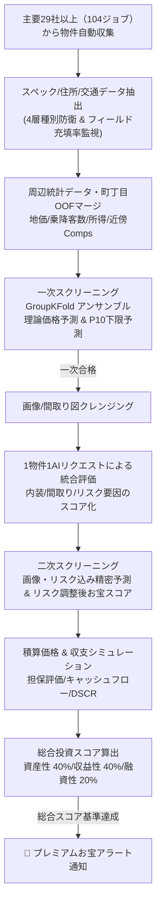

# プロジェクトのビジョン・設計意図・開発状況 (Project Vision, Design Intent & Status)

本プロジェクトが何を目指して作られているのか、どのような意図で設計されているのか、そして現在の開発状況についてまとめます。

---

## 1. プロジェクトのビジョン (Project Vision)

単なる「不動産情報のクローリング・データベース保存システム」にとどまらず、**「市場の歪みから眠っている優良な投資・割安物件を自動でスクリーニングし、資産性・融資性・収益性の3軸＋予測不確実性（$P_{10}$ 下限予測値）で多角評価するスマート不動産分析パイプライン」**を目指しています。

---

## 2. アーキテクチャと設計意図 (Design Intent)

### 2.1 非同期・再帰連鎖 (Fire-and-Forget パターン) ＆ Cloud Workflows 統合分散実行
*   **設計意図**: GCP Cloud Run Jobs / Cloud Workflows 環境での高効率な分散実行とコスト最適化。
*   **仕組み**: `Start ➔ Region ➔ Area ➔ List ➔ Detail` のステップ分割に加え、`aiohttp`（共有セッションプール）による高速静的HTML取得と、動的レンダリング・WAF保護サイト向けの `Playwright` ステルスブラウザを併用するハイブリッド構成を採用。
*   **Unified Site Registry**: [`site_registry.py`](../../src/crawler/package/site_registry.py) により、新規サイト定義からディスパッチャ・タスク分散・URLルーター・ML学習対象までの10箇所を一元管理します。

### 2.2 一項目一関数 (One-Item-One-Method) & 4基底モデル・フィールド名統一規約
*   **仕組み**: 物件スペックのパースは各項目ごとに `get_<field>` 専用メソッドに分離（[parser_design_guidelines.md](../implementation/parser_design_guidelines.md)）。
*   **モデル階層**: `MansionBaseModel`, `KodateBaseModel`, `TochiBaseModel`, `InvestmentBaseModel` の4つの種別別リファレンス基底モデルと共通フィールド命名規約（[field_naming_standards.md](../3_data_models/field_naming_standards.md)）により、全116テーブル間のスキーマ型整合性を保証します。

### 2.3 物件種別誤判定廃絶の4層防衛 (4-Layer Property-Type Defense)
1. **DOMノイズ除去**: グローバルナビ・ヘッダー・フッター・サイドバーを除去した本文領域のみを判定。
2. **物理構造 × 収益状態の直交分離**: オーナーチェンジ区分マンションの一棟アパート誤分類や、非住宅ビル・店舗の居住用アパート混入を遮断。
3. **ラベル限定スペック判定**: 自由記述の備考欄による誤爆を排除。
4. **Post-Parse 物理不変条件ゲート**: パース後の面積・階数・利回り整合性を検証。

### 2.4 空間・建物リーク防止 ML ＆ リスク調整後お宝判定 ($P_{10}$ Risk-Adjusted Bargain Score)
*   **GroupKFold**: 同一建物・同一町丁目が Train/Val に跨らない `GroupKFold` と町丁目 OOF Target Encoding により、リークのない高精度な価格推定を実現。
*   **下限予測値 $P_{10}$**: アンサンブルの予測不確実性から下限予測値 $P_{10}$ を算出し、不確実性を差し引いてもなお割安な物件のみを通知します。

---

## 3. 現状の開発・実装状況 (Current Status)

| 機能エリア | 実装状況 | 詳細 |
| :--- | :---: | :--- |
| **対象29社・104ジョブのクローラー** | **完了** | 主要不動産会社・ポータルサイト計29社（104ジョブ）の居住用/投資用物件収集ロジック実装済み。 |
| **データベース設計（全116テーブル）** | **完了** | 4基底モデル継承による各社・物件種別テーブルおよび価格履歴・建物マスタ・評価テーブルの計116モデル定義完了。 |
| **統計・マイクロロケーション特徴量** | **完了** | 自治体統計・駅乗降客数・公示地価に加え、町丁目OOF単価アンカー・近傍Comps特徴量を統合。 |
| **アンサンブル予測 & $P_{10}$ 割安判定** | **完了** | LightGBM / XGBoost / CatBoost / RF の重み付きアンサンブル、Duan's smearing 補正、下限予測値 $P_{10}$ スコアリング実装済み。 |
| **1物件1AIリクエスト統合抽出** | **完了** | Gemini API による画像・リスク・スペックの1リクエスト一括抽出実装済み。 |
| **可観測性 & 3層ハーネス** | **完了** | マルチ障害テレメトリ、フィールド別充填率監視、Antigravity `hooks.json` および `test_architecture_harness.py` による常時品質強制。 |

---
**更新日**: 2026年10月30日  
**ステータス**: 設計書・状況報告（正式版）
