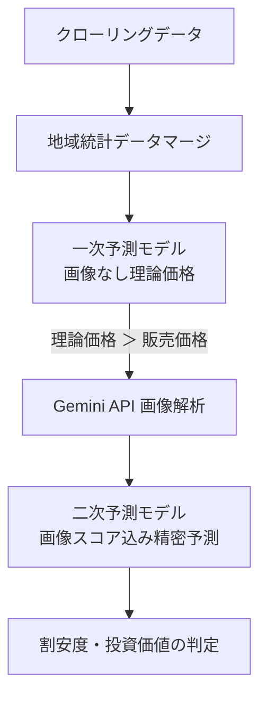

# 機械学習モデル・学習プロセス仕様書 (Machine Learning Model & Training Specifications)

本ドキュメントは、本システムで投資・割安物件を判定するために用いる機械学習モデルの設計、現在の学習プロセス（方法論）、および現状の課題と今後の改善点について定義します。

---

## 1. 概要 (Overview)

本システムは、不動産市場における「市場の歪み（本来の価値より安く売り出されている物件）」を検出するため、機械学習を用いた2段階のスクリーニング（価格予測）を導入しています。



---

## 2. 現状の学習方法論 (Current Methodology)

学習プロセスは [train.py](file:///c:/Users/weare/Documents/realestate_crawler/src/crawler/package/ml/train.py) で制御されています。主なプロセスは以下の通りです。

### 2.1 データのロードと地域統計マージ
各社（三井、住友、東急、野村、ミサワ）のマンション（Mansion）モデルから取得した全レコードに対し、以下の周辺統計データを住所や最寄り駅をキーとして結合（マージ）します。

*   **自治体ポテンシャル**: `MunicipalPotential` から「人口増加率」および「平均所得」を取得。マスタ欠損時はサイレントなフォールバックを行わず、欠損エラー（`ValueError`）として可視化する。
*   **駅ポテンシャル**: `StationPotential` から「乗降客数」を取得。マスタ欠損時はサイレントなフォールバックを行わず、欠損エラー（`ValueError`）として可視化する。
*   **平均地価**: `LandPricePotential` から該当市区町村の「住宅地平均地価」を取得。
*   **定性評価（AIプロンプト）連携**: 定性評価プロンプトには、客観マクロ基礎データ（最新人口動態、所得、駅乗降客数、ハザード情報）を直接注入する。**機械学習モデルで算出した理論予測価格・割安額・割安率はプロンプトへ一切渡さず**、AIの客観的定性判断の独立性を保証する。

*   自治体データ未検出: サイレントフォールバックを廃止。日次パイプライン（`run_pipeline.py`）起動時に `sync_all_potentials.py` で事前同期を強制し、未登録時はエラーとして処理を停止・通知。
*   最寄り駅データ未検出: 一律1万人等の安易なフォールバックを廃止。駅データ未登録時は欠損エラーとして検知。
*   平均地価未検出: 全国47都道府県ベース地価マスタ（`PREFECTURE_BASE_LAND_PRICES`）に基づき、都道府県および行政区区分（都心部/政令区/中核市/一般市/町村・郡部）に応じた動的基準地価（住宅地・商業地）を自動適用（一律35万円/㎡の固定補完を廃止）。
*   アクセス所要時間（`walk_min`）: バス利用物件（`busUse1=1` または交通欄に「バス」表記）の場合、バス乗車分数×1.5＋バス停徒歩分数を「等価アクセス分数（`effective_walk_min`）」として算出し、駅至近物件との誤認を防止。
*   超高層・都心プライム補正: 30階以上のタワーマンション高層階、および都心特区（千代田・中央・港・渋谷・新宿等）におけるブランドレジデンスの平米単価プレミアムを特徴量へ反映。
*   築年数（`chikunen`）: 現在日と `chikunengetsu`（築年月）の差分日数 / 365.25。築年月が欠損の場合は構造別中央値補完（木造38年、RC30年）。
*   専有面積（`area`）: マンションにおいて500㎡超の外れ値は70㎡に安全サニタイズ。
*   管理費/修繕費: 欠損時は `0` (円)、異常値（100万円超などパース単位バグ）は中央値キャップ。
*   画像スコア (`interior_score`, `layout_score`): 欠損時は `3.0` (中間値)

#### 学習用ダミーデータの生成
実データ（クローリング済みDBレコード）が10件未満の場合、機械学習パイプラインの動作を担保するため、500件の擬似物件レコードを生成して学習を行います。

### 2.2 使用する特徴量 (Features)
予測フェーズに応じて2パターンの特徴量セット（データ列）を用いています。

#### 2.2.1 土地モデルにおける地目ディスカウント適正化 ＆ 特徴量再編 (Issue #1294, #1298, #1299)
全国約4.8万件の本番実データにおける同一市区町村内の実勢坪単価比率（宅地中央値基準）の統計的分布に基づき、`parse_chimoku_features` のディスカウント係数を以下の通り実証的に更新しています。

| 地目カテゴリ | サンプル数 | 実勢比率中央値 | 25パーセンタイル | 75パーセンタイル | 採用スコア (`chimoku_score`) |
| :--- | :---: | :---: | :---: | :---: | :---: |
| **宅地** | 33,439件 | 1.000 | 0.715 | 1.376 | **1.00** |
| **畑** | 1,002件 | 0.944 | 0.627 | 1.184 | **0.94** |
| **未設定 (`-` / 空白)** | 1,038件 | 0.925 | 0.704 | 1.216 | **0.95** |
| **雑種地** | 758件 | 0.919 | 0.588 | 1.327 | **0.92** |
| **現況宅地 (登記簿は他)** | 896件 | 0.891 | 0.586 | 1.214 | **0.90** |
| **原野** | 41件 | 0.774 | 0.367 | 1.050 | **0.77** |
| **山林** | 752件 | 0.678 | 0.371 | 1.011 | **0.68** |
| **田** | 343件 | 0.632 | 0.317 | 1.106 | **0.63** |
| **その他 (保安林・公衆用道路等)** | 60件 | 0.468 | 0.287 | 0.772 | **0.50** |

#### 2.2.2 土地規模格差補正および低価格帯補正特徴量（Issue #1298, #1338）
OOF深層残差分析により判明した大面積帯（268㎡超）の単価逓減乖離、取引事例比較法の評価面積バグ、および土地固有属性（建築条件・地勢・防火規制・私道負担・借地権）の未反映を是正するため、以下の特徴量を新設・統合しています。

1. **`mkt_comparison_value`（取引事例比較法アンカーの土地面積適正化 - Issue #1338）**:
   - 土地（`tochi`）の評価対象面積（`eval_area`）には建物面積ではなく有効敷地面積（`tochi_area`）を適用し、同一市区町村の土地実勢平米単価×敷地面積による正確な比準価格を算出（従来の50㎡固定フォールバックバグを根絶）。
2. **`log_tochi_menseki`（対数地積）**:
   - $\log(\max(1.0, \text{tochi\_menseki}))$。樹木モデル（LightGBM/CatBoost/XGBoost）における面積の非線形性・単価逓減カーブの連続的学習を促進。
3. **`tochi_scale_disparity` / `scale_discount`（規模格差補正係数）**:
   - 国税庁財産評価基本通達の規模格差補正率および不動産鑑定理論に準拠。標準地積（戸建・土地: 150㎡、アパート: 300㎡）を超える面積帯において、$\text{scale\_disparity} = \max(0.15, (\text{standard\_area} / \text{tochi\_area})^{0.18})$ を算出し、過大な総額見積もりを抑制。
4. **`narrow_road_penalty`（狭小道路ペナルティ）**:
   - 接道幅員が4m未満（要セットバック）かつ敷地面積に対して接道が不十分な場合の減価補正係数。間口（`maguchi`）および道路幅員（`roadWidth`）の抽出時は、各社モデル固有カラム（`setsumen`, `douroHaba`, `douro` 等）からも網羅的にフォールバック抽出する。
5. **土地固有属性および権利・瑕疵特徴量の全面統合（Issue #1338）**:
   - **建築条件フラグ (`has_kenchiku_joken`)**: `kenchikuJoken` や備考テキストから「建築条件付（条件なし・外し可を除く）」を検出し、ハウスメーカー建築条件付き土地の価格構造差を学習。
   - **地勢・高低差スコア (`chisei_score`, `is_flat_terrain`)**: `chisei` / `chimokuChisei` / 備考テキストから平坦（1.00）、高台・ひな段（0.92）、傾斜地・法面・擁壁・崖（0.78）を数値化し、造成・擁壁工事費負担による減価を反映。
   - **防火規制スコア (`bouka_score`)**: `boukaChiiki` 等から防火地域（1.05）、準防火地域（1.00）、指定なし・法22条区域（0.95）を数値化。
   - **私道負担フラグ (`has_private_road_burden`)**: `privateRoadBurden` / `shidoMenseki` / 備考テキストから私道負担あり（1.0）を検出。
   - **借地権・地代負担・心理的瑕疵の配線**: `is_leasehold`, `monthly_land_rent`, `annual_land_rent`, `land_rent_liability`, `land_rent_ratio`, `has_psychological_defect` を `FEATURE_SETS` に統合。
6. **戸建て（kodate）・アパート（apartment）モデルへの横断展開（Issue #1299, #1338）**:
   - 土地を主要な構成要素とする戸建ておよびアパートモデルにおいても、上記土地評価特徴量・権利特徴量を一貫投入し、土地評価精度を全面的に底上げする。

| 特徴量名 | 説明 | 一次予測 | 二次予測 |
| :--- | :--- | :---: | :---: |
| `area` | 専有面積 (㎡) | Yes | Yes |
| `chikunen` | 築年数 (年) | Yes | Yes |
| `walk_min` | 最寄り駅からの徒歩分数 (分) | Yes | Yes |
| `kanrihi` | 管理費 (円) | Yes | Yes |
| `syuzen` | 修繕積立金 (円) | Yes | Yes |
| `pop_growth` | 自治体の人口増加率 | Yes | Yes |
| `income` | 自治体の平均所得 | Yes | Yes |
| `passenger_volume` | 最寄り駅の乗降客数 | Yes | Yes |
| `average_land_price` | 周辺の平均地価 (円/㎡) | Yes | Yes |
| `time_diff_months` | 基準日（現在）からの経過月数 | Yes | Yes |
| `macro_repi` | 物件種別連動 国交省不動産価格指数 | Yes | Yes |
| `macro_jgb_10y` | 新発10年物国債利回り (%) | Yes | Yes |
| `macro_nikkei` | 日経平均株価月末終値 (円) | Yes | Yes |
| `macro_reit` | 東証REIT指数月末終値 (pt) | Yes | Yes |
| `macro_construction_cost` | 建設物価指数（RC/住宅） | Yes | Yes |
| `is_legacy_data` | 2024年以前の過去収集データフラグ | Yes | Yes |
| `interior_score` | Gemini API による内装評価スコア (1.0〜5.0) | - | **Yes** |
| `layout_score` | Gemini API による間取り評価スコア (1.0〜5.0) | - | **Yes** |

#### マクロ経済・時系列特徴量および時間減衰学習重み (Time-Decay Sample Weight)
- **マクロ指標結合**: 物件の掲載年月 (`inputDate` の YYYY-MM) に基づき、`MacroEconomicIndex` から当時の不動産価格指数、長期金利、株価、REIT指数、建設物価指数を自動マージ。
- **時間減衰重み付け**: 掲載日からの経過日数 $\Delta t$ に応じて $w = \exp(-0.0005 \times \Delta t)$（半減期約3.8年、下限0.20）を算出し、最新の価格水準を重視しつつ過去データの構造関係を安定学習。
- **旧データ欠損値防御**: 過去データに存在しない新設属性（`kaisuKouzou`、`traffic`、一部設備フラグ等）はデフォルト値・NaNで安全にフォールバックし、モデルが例外なく処理できるように保証。

#### 特殊フラグ・権利関係の生のHTML全テキスト抽出仕様
- `is_saikenchiku_fuka`: 物件の生のHTML全体（または全抽出テキスト）から「再建築不可」の文字列が存在するかを直接判定。
- `is_shigaika_chousei`: 物件の生のHTML全体（または全抽出テキスト）から「調整区域」「市街化調整」の文字列が存在するかを直接判定。
- `rights_ratio`: 物件の生のHTML全体（または全抽出テキスト）から「底地」「貸地」（0.20）、「定期」「定借」（0.70×残存期間比）、「借地」「賃借」（0.65）のキーを包括検索して適用。
- `monthly_land_rent`: 物件に記録された月額地代（万円）。
- `annual_land_rent`: 年間支払地代（万円、`monthly_land_rent * 12`）。
- `land_rent_liability`: 地代の資本化負債価値（万円、`annual_land_rent / 0.05`。還元利回り5.0%仮定）。
- `land_rent_ratio`: 販売価格に対する年間地代比率（`annual_land_rent / price_man`）。借地物件における地代支払負担による価値減価をモデルが直接学習・説明可能とする。
- `maguchi`: 間口未抽出（0.0m）時はペナルティなし（標準値 6.0m）として扱い、過剰な減価を防ぐ。

### 2.3 モデルのアンサンブル・評価・最適化プロセス
5分割・3反復（計15サイクル）交差検証（Repeated 5-Fold Cross Validation）を用いて、以下の4つのアルゴリズムを学習・評価します。

1.  **LightGBM** (`LGBMRegressor`)
2.  **XGBoost** (`XGBRegressor`)
3.  **CatBoost** (`CatBoostRegressor`)
4.  **RandomForest** (`RandomForestRegressor`)

#### 評価指標 (Metrics)
*   **MAPE (平均絶対パーセント誤差)**: モデルの最良判定・最適化基準。
*   **MAE (平均絶対誤差)**: 金額ベース（万円）の平均ズレ。
*   **R² (決定係数)**: モデルの説明力。

#### 2.4 対数変換過小予測バイアス補正 (Duan's Smearing Estimator)
目的変数として平米単価の対数変換 $\ln(\text{単価})$ を学習させた場合、イェンセンの不等式 $E[\exp(X)] \ge \exp(E[X])$ により、単に指数変換 $\exp(\hat{y})$ を行うと真値に対して構造的な過小評価（下振れ）が発生します。
これを補正するため、各モデル・物件種別の交差検証残差からスミアリング係数 $s = \frac{1}{N}\sum_{i=1}^N \exp(y_i - \hat{y}_i)$ を算出し、推論時に乗算して不偏予測値を復元します。

#### 2.5 データ駆動型アンサンブル最適重み (Dynamic Blending)
各アルゴリズムの予測比率は固定値ではなく、Repeated CVのOut-Of-Fold (OOF) 予測値に対し、MAPE最小化を目的関数とする制約付き最適化（重み和=1.0, 各重み>=0）を実施して最適な重みベクトル（`ensemble_weights.joblib`）を導出・適用します。

#### 2.6 特徴量セットの一元管理 (`FEATURE_SETS`)
学習時（`train.py`）と推論時（`predict.py`）の特徴量ズレ（Feature Drift）を防ぐため、`package.ml.features.FEATURE_SETS` にて単一の正（Single Source of Truth）として種別（mansion, kodate, apartment, tochi）×段階（first, second）ごとに列定義を一元管理します。

#### 2.7 経済的価値創出力評価・外れ値除去仕様 (Economic Value Capitalization & Outlier Defense)
「予測値＝物件価値（経済的価値を生む力）」「差分＝純粋な割安・割高」を実現するためのモデル仕様：
1. **潜在容積延床面積 (`potential_floor_area`)**:
   - 敷地面積 × 指定容積率（FAR）により、敷地が創出可能な総延床面積を算出し、都心高容積率商業地（六本木・青山・神宮前等）の経済価値を適正化。
2. **規模非線形減退係数 (`scale_discount`)**:
   - 1,000㎡超の大規模原野・山林において、平米単価の単純乗算による過大予測（数千万円の山林が数十億円と評価される現象）を防止するため、$(1000 / \text{area})^{0.35}$ の規模減退を適用。
3. **土地なし区分所有の誤分類防衛 (Landless Unit Rerouting)**:
   - 投資用戸建てテーブル等に混入した土地面積0㎡・RC造・50㎡未満の区分所有ワンルームを検知し、戸建てモデル（地価加算）ではなくマンションモデルへ自動リルート。
4. **築年数欠損インピュテーション**:
   - `builtYear`や`buildDate`等のカラム名差異を網羅抽出。完全欠損時は0年（新築）ではなく保守的中間値（木造38年、RC32年）を補完。
5. **想定純賃料還元価値アンカー (`income_approach_value`)**:
   - 立地・面積・構造・築年数に応じた想定月額賃料を地域期待利回り（Cap Rate 4.0%〜6.5%）で還元し、全物件種別における客観的経済価値アンカーとしてモデルへ供給。
6. **戸建て低価格帯・築古過大評価防止 (`demolition_cost_discount`, `building_depreciation_ratio`) (Issue #1304)**:
   - 木造戸建ての法定耐用年数（22年）超過後の建物残存価値の底打ちカーブ（`building_depreciation_ratio`）および、更地渡し・古家付き土地としての解体費用控除（`demolition_cost_discount`）を導入し、2,300万円以下低価格帯における過大バイアス（+57.9%）を是正。
7. **マンション築古・駅遠過小評価是正 (`mansion_vintage_floor`, `scale_vintage_interaction`) (Issue #1305)**:
   - 築30年超過後の減価底打ちスプライン特徴量（`mansion_vintage_floor`）および総戸数（スケールメリット）×築年数の交差項（`scale_vintage_interaction`）を導入し、築35年超の過小評価（-14.8%）および徒歩15分超の過小評価（-11.5%）を是正。
8. **土地低価格帯・郊外低需要エリア補正 (`low_demand_land_discount`) (Issue #1306)**:
   - 平均公示地価・路線価が著しく低いエリア（平米単価5万円以下）または市街化調整区域における需要減退を指数関数的に織り込む非線形減価特徴量（`low_demand_land_discount`）を導入し、1,800万円以下低価格帯の過大評価（+78.7%）を是正。
9. **価格帯別不均一分散（Heteroskedasticity）に対応する学習時サンプル重み (`calculate_time_decay_weights`) (Issue #1307)**:
   - 低価格帯のパーセント誤差（MAPE）に対するペナルティを高めるため、価格水準に応じた不均一分散調整重み（$\propto 1 / \sqrt{\ln(\max(e, \text{price\_man}))}$）を時間減衰重みに乗算し、低価格帯の学習精度を底上げ。

---

## 3. 現状の方法論における改善済・今後の継続課題

### 3.1 欠損値補完（デフォルト補完）の改善
*   周辺エリア（市区町村単位で取れない場合は都道府県単位の平均など）のより広域な統計データを段階的フォールバック（Backoff）として適用。
*   画像スコアの欠損は中間値（3.0）に過度に依存せず、欠損指示子やツリーモデルの欠損値分岐を活用。

### 3.2 カテゴリカル（テキスト）データの活用
*   LightGBMやCatBoostのカテゴリカル変数ネイティブサポートおよびOOF Target Encodingを活用。

### 3.3 モデル保存パスの相対パス動的解決
*   `__file__` 起点の動的パス解決により、コンテナ内外（Docker/ホスト）を問わず同一コードで動作保証。

---

## 4. 外部基礎データ全14種の一括同期・定期更新・GCS永続化・新規クロール反映仕様 (Issue #1360, #1366)

### 4.1 概要と一括同期オーケストレータ
[`scripts/sync_all_potentials.py`](../../src/crawler/scripts/sync_all_potentials.py) および日次バッチ [`scripts/ops/run_ml_pipeline.py`](../../src/crawler/scripts/ops/run_ml_pipeline.py)（Cloud Scheduler `realestate-ml-pipeline-daily-prod`: **毎日 05:10 JST** 起動）により、本システムが参照する**全14種の外部公的データ・市場マスタ・空間キャッシュ**を API キー課金ゼロ（AI不使用）で定期同期・非破壊洗い替え（Upsert）します。

### 4.2 全14種の外部・参照データ一覧と定期更新スケジュール（SSOT）

| # | データ名称 | 保存先 (DB テーブル / GCS キー) | 同期スクリプト | 原典公表周期 | 自動更新スケジュール / 鮮度TTL (`--respect-ttl`) |
| :---: | :--- | :--- | :--- | :---: | :--- |
| **1** | **総務省 e-Stat 人口・世帯・課税所得** | `municipal_potential` (`MunicipalPotential`) | [`sync_estat_municipalities.py`](../../src/crawler/scripts/data_import/sync_estat_municipalities.py) | 年次 | **月次更新**（TTL 30日、空テーブル時は即時取得） |
| **2** | **国土数値情報 S12 駅別乗降客数** | `station_potential` (`StationPotential`) | [`import_mlit_stations.py`](../../src/crawler/scripts/data_import/import_mlit_stations.py) | 年次 | **月次更新**（TTL 30日、空テーブル時は即時取得） |
| **3** | **国土数値情報 A29 用途地域規制** | `urban_planning_zone_potential` (`UrbanPlanningZonePotential`) | [`import_hazard_and_urban_zones.py`](../../src/crawler/scripts/data_import/import_hazard_and_urban_zones.py) | 年次 | **月次更新**（TTL 30日、空テーブル時は即時取得） |
| **4** | **国土数値情報 洪水・土砂災害ハザード** | `hazard_map_potential` (`HazardMapPotential`) | [`import_hazard_and_urban_zones.py`](../../src/crawler/scripts/data_import/import_hazard_and_urban_zones.py) | 年次 | **月次更新**（TTL 30日、空テーブル時は即時取得） |
| **5** | **社人研 (IPSS) 2035年将来推計人口** | `future_population_potential` (`FuturePopulationPotential`) | [`import_ipss_future_population.py`](../../src/crawler/scripts/data_import/import_ipss_future_population.py) | 5年ごと | **四半期更新**（TTL 90日、空テーブル時は即時取得） |
| **6** | **国交省 立地適正化計画（居住/都市機能誘導区域）** | `urban_induction_zone_potential` (`UrbanInductionZonePotential`) | [`import_urban_induction_zones.py`](../../src/crawler/scripts/data_import/import_urban_induction_zones.py) | 年次 | **月次更新**（TTL 30日、空テーブル時は即時取得） |
| **7** | **自治体・駅 過去時系列推移（3年CAGR）** | `municipal_yearly_potential` / `station_yearly_potential` | [`sync_yearly_historical_potentials.py`](../../src/crawler/scripts/data_import/sync_yearly_historical_potentials.py) | 年次 | **月次更新**（TTL 30日、当月未同期時は即時更新） |
| **8** | **国交省 L01地価公示（3月）・L02基準地価（9月）**<br>（市区町村平均＋全国4.7万標準地座標） | `land_price_potential` + `land_price_point_potential` (`LandPricePointPotential`) | [`import_mlit_land_prices.py`](../../src/crawler/scripts/data_import/import_mlit_land_prices.py) | 年2回 (3月・9月) | **月次更新（公表期3・4・9・10月はTTL 14日、他月は30日）**。1,000件単位マルチロー `INSERT ... ON DUPLICATE KEY UPDATE` により高速一括同期 |
| **9** | **賃料相場・期待利回りベンチマーク**<br>（e-Stat・JREI・自社DB集計・ポータル実クロール） | `rent_market_potential` / `cap_rate_benchmark_potential` + GCS `rag/raw/rent_mesh/` | [`sync_rent_and_cap_rate_potentials.py`](../../src/crawler/scripts/data_import/sync_rent_and_cap_rate_potentials.py) | 随時 / 半年 | **自社DB集計は日次更新**、外部ポータル賃料メッシュ収集（`enable_live_crawl=True`）は**週次（日曜）更新** |
| **10** | **マクロ経済指標（国交省REPI・財務省10年国債利回り・フラット35・日経平均・東証REIT・建設物価・コアCPI）** | `macro_economic_index` (`MacroEconomicIndex`) | [`sync_macro_economic_indices.py`](../../src/crawler/scripts/data_import/sync_macro_economic_indices.py) | 月次 / 日次 | **日次チェック・当月分自動同期**。財務省公式国債金利CSV（`jgbcm.csv`）等の無料公開統計から最新月次レコードを自動補完・更新し、将来年月でもデータ切れを起こさない |
| **11** | **国土地理院 (GSI) 住所・町丁目ジオコーディング座標** | ローカル `data/gsi_geocode_cache.json` ⇄ **GCS `ml_reference_data/gsi_geocode_cache.json`** | [`sync_mlit_open_geo_and_transactions.py`](../../src/crawler/scripts/data_import/sync_mlit_open_geo_and_transactions.py) | 日次差分 | **日次差分更新＋GCS永続化**。既解決町丁目はスキップし、新規クロールで出現した未解決町丁目のみGSI API解決 |
| **12** | **国土地理院 (GSI) 5m/10m 標高DEM微地形**<br>（標高・傾斜角・南向きスコア・窪地深さ） | ローカル `data/gsi_dem_terrain_cache.json` ⇄ **GCS `ml_reference_data/gsi_dem_terrain_cache.json`** | [`sync_mlit_open_geo_and_transactions.py`](../../src/crawler/scripts/data_import/sync_mlit_open_geo_and_transactions.py) | 日次差分 | **日次差分更新＋GCS永続化**。新規座標の11mメッシュのみタイル取得・Horn法微地形計算 |
| **13** | **国交省 実成約単価 (`XIT001`/公式CSV) ＆ 自社掲載終了成約スプレッド** | ローカル `data/mlit_transaction_benchmarks.json` ⇄ **GCS `ml_reference_data/mlit_transaction_benchmarks.json`** | [`sync_mlit_open_geo_and_transactions.py`](../../src/crawler/scripts/data_import/sync_mlit_open_geo_and_transactions.py) | 四半期 / 日次 | **日次再集計＋GCS永続化**。日々の掲載終了物件（`is_published=False`）と現在売出物件のスプレッドを反映 |
| **14** | **マンション建物マスタ ＆ MLモデル4種別・階層型OOFエンコーダ** | `building_master` + **GCS `ml_models/*.joblib` (`location_encoders.joblib` 含)** | [`generate_building_master.py`](../../src/crawler/scripts/data_import/generate_building_master.py) / [`train.py`](../../src/crawler/package/ml/train.py) | 日次 / 週次 | `BuildingMaster` は**日次更新**。MLモデル・`location_encoders.joblib` は**週次（毎週日曜）自動再学習**により新規町丁目・最新相場を追随 |

### 4.3 Cloud Run エフェメラル環境における GCS 双方向キャッシュ同期 (`open_data_cache_sync.py`)
Cloud Run Service（`realestate-api-prod`）および Cloud Run Job（各社クローラー・`realestate-ml-pipeline-prod`）のローカルディスクはコンテナ再起動ごとに初期化されるため、JSON キャッシュ3種（`gsi_geocode_cache.json`, `gsi_dem_terrain_cache.json`, `mlit_transaction_benchmarks.json`）は以下の通り GCS（`STORAGE_BUCKET` 配下 `ml_reference_data/`）と自動同期します。
1. **初回参照時の自動プル (`ensure_local_cache_from_storage`)**: ローカル `data/` にファイルが存在しない場合、ストレージマネージャ経由で `ml_reference_data/<filename>` を自動ダウンロードしてからメモリへ展開する。
2. **バッチ更新完了時の自動プッシュ (`upload_cache_to_storage`)**: `sync_mlit_open_geo_and_transactions.py` 実行完了時に更新済み3ファイルを `ml_reference_data/` へアップロードし、全コンテナ間で単一の最新キャッシュを共有する。

### 4.4 今後クロールされる新規物件へのリアルタイム完全伝播保証
新しくクロールされた物件レコード（詳細ページ保存直後のインライン査定 [`_perform_inline_ml_evaluation`](../../src/crawler/package/api/api.py)、URL指定オンデマンド査定 `/api/evaluation/predict-by-url`、および日次バルク推論 [`run_bulk_ml_evaluation.py`](../../src/crawler/scripts/ops/run_bulk_ml_evaluation.py)）のすべてで同一の特徴量・評価品質を保証します：
1. **パーサー層での間口・道路幅員厳密分離**: `ParserBase` 共通メソッドおよび各社固有パーサー（`MitsuiParser`, `SumifuParser` 等）の双方で、`「接面8.5m 公道 幅員4.0m」` 等の接道文字列から幅員（`douroHaba`/`roadWidth`）と間口（`setsumen`/`maguchi`）を混同せず抽出する。
2. **APIシリアライザの全属性・別名カラム完全保持 (`serialize_property`)**: インライン推論や URL 指定推論が経由する [`serialize_property`](../../src/crawler/package/ml/inference/api_client.py) において、`propertyType` に加え会社別カラム名（`setsumen`, `douroHaba`, `douro`, `okuyuki`, `chisei`, `setsubi`, `kenchikuJoken`, `boukaChiiki`, `privateRoadBurden`, `kuiki`, `chidai`, `busUse1` 等）を欠落なく転送し、Django モデル直接評価時と 100% 同一の特徴量ベクトルを生成する。
3. **未見町丁目・新規座標のオンデマンド軽量解決**: 新規クロール物件が GCS キャッシュ未登録の新規町丁目だった場合、単発推論時（バルク一括実行中および単体テスト実行中を除く）に国土地理院 API へ軽量タイムアウト（2.5秒）でオンデマンド照会して座標・5m/10m DEM微地形を即時解決し、次回日次バッチで GCS キャッシュへ恒久統合する。
4. **インライン評価での DCF・期待利回り即時永続化**: 新規クロール時の `_run_stage1_eval` / `_run_stage2_and_notify` でも決定論的 DCF エンジン（`evaluate_dcf_and_yields`）を即時実行し、`dcf_theoretical_price`・`expected_gross_yield`・`expected_net_yield`・`estimated_annual_rent` を初回保存時点から `PropertyEvaluation` に格納する。

### 4.5 非破壊性の担保（自然キー動的結合）
マスタデータが定期洗い替え（Upsert）された場合でも、既存の物件データ（各社モデルレコード）や過去の査定データ（`PropertyEvaluation`）との結合関係が壊れないよう、DB物理外部キー（ForeignKey）によるID結合を廃止し、**自然キー（都道府県名・市区町村名・町丁目キー・駅名・座標メッシュキー）による動的結合（Dynamic Natural Key Join）** を採用しています。

---

## 5. 低コスト画像解析アーキテクチャ設計 (Low-Cost Vision AI Architecture)

### 5.1 課題と目的
一次スクリーニング（割安判定）を通過した物件に対し、間取りの使いやすさ（`layout_score`）や内装・外観の劣化・修繕状況（`interior_score`）を数値化して二次予測に反映します。
しかし、数万件規模の物件画像すべてを高コストなクラウドVision API（Gemini 1.5 Pro, GPT-4o 等）で解析すると、毎月多額のクラウドAPI課金が発生するリスクがあります。

### 5.2 低コスト化手法の比較検討

| 手法 | 月額APIコスト | 推論速度 | 特徴・メリット | デメリット・課題 |
| :--- | :---: | :---: | :--- | :--- |
| **案A: 超軽量クラウドVLM (`Gemini 1.5 Flash-8B`)** | **数十円〜数百円** (無料枠内可) | 500ms〜1s | 512px WebP圧縮＋pHash重複除外＋上位5%厳選でトークン消費を最小化。高度な文脈理解・間取り読解力を保持。 | クラウド外部API依存が残る（通信エラー・レート制限）。 |
| **案B: ローカルコンテナOSS VLM (`Moondream2 1.86B` / `Qwen2-VL-2B`)** | **完全0円** | 1s〜3s (CPU/GPU) | Dockerコンテナ内オンプレ実行。外部通信・API課金ゼロ。プライバシー完全保護。 | コンテナメモリ（2〜4GB）を消費。初回モデルダウンロードが必要。 |
| **案C: 古典的ルールベースCV (`OpenCV` / `Pillow`)** | **完全0円** | **0.01秒** (瞬時) | エッジ検出（ラプラシアン分散）による外壁クラック・ボケ判定、HSV明度・彩度ヒストグラムによる日当たり・清潔度測定、輪郭解析による間取り整形度測定。 | 「リフォーム済みのおしゃれな内装」「動線が優れた間取り」などの高次セマンティクス理解は限定的。 |
| **案D: 二段階ハイブリッド方式（推奨アーキテクチャ）** | **実質0円〜数十円** | **0.05s〜0.5s** | **全件をOpenCV（案C）で瞬時・無料フィルタリング＆基本スコアリングし、投資スコア上位2〜5%のお宝候補のみFlash-8B（案A）またはローカルVLM（案B）で詳細査定。** | パイプライン構成が2段階になるが、コスト効率と判定精度のバランスが最も優れる。 |

---

## 6. 古家付き土地（建物残存価値・解体費用控除・再建築不可特則）査定仕様

### 6.1 課題と不動産実務上の背景
土地（Tochi）として売り出されている物件の中には、「古家あり」「現況古家付」「上物あり」といった中古建物が付帯する物件が多数存在します。
これらに対し単に更地価格を適用すると、以下の致命的な乖離が生じます：
1. **解体費用負担（買い手コスト）の未考慮**: 「現況渡し」の場合、新築建築時に買主が100〜250万円の解体費用を負担するため、更地価格から解体費用を差し引く必要があります。
2. **再建築不可における古家の「既得権」価値**: 接道義務を満たさない再建築不可地では、**解体すると二度と建物を建てられない**ため、古家を解体することは経済的に大損失となります。古家をリフォーム・リノベーションして住む、または戸建て賃貸（賃料4〜8万円/月）として運用する場合、古家の存在自体が極めて高い収益価値（既得権価値）を生み出します。
3. **古家の再生・オプション価値**: 建物の骨組み・基礎がしっかりしている場合、更地にして売るよりも、戸建賃貸やDIY賃貸として収益還元した方が高価値となる「お宝物件（バリューアップ・オプション）」が存在します。

### 6.2 特徴量と評価ロジック仕様
1. **古家検知フラグ (`is_furuya`)**:
   - 物件テキスト（物件名、備考、現況、権利関係、生HTML）から「古家あり」「古家付」「上物あり」「建物あり」等を正規表現検出。
2. **解体条件フラグ (`has_demolition_condition`)**:
   - 「更地渡し」「解体更地渡し」「売主負担で解体」等を検出し、買主の解体費負担がゼロであることを判定。
3. **解体費用控除 (`furuya_demolition_cost`)**:
   - `has_demolition_condition == 1` または `is_saikenchiku_fuka == 1`（解体禁止）の場合は `0.0万円`。
   - それ以外は建物構造（木造1.4万円/㎡、鉄骨1.8万円/㎡、RC 2.5万円/㎡）×建物面積（不明時80㎡想定）を更地価格から控除。
4. **古家利用・戸建賃貸還元価値 (`furuya_usable_value`)**:
   - 古家をリフォームして戸建て賃貸運用する場合の想定年間純賃料を還元利回り（再建築不可なら10%、通常なら8%）で資本還元し、リノベ工事費（3万円/㎡）を控除したネット再生価値を算出。
5. **古家オプション価値 (`furuya_option_value`)**:
   - $\max(0, \text{古家再生価値} - (\text{土地更地価格} - \text{解体費}))$
   - 土地としての更地手取り価格を上回る「建物の隠れた収益価値」を数値化し、お宝度を査定。

---

## 7. 土地形状（区画形状）の数理幾何評価仕様 (Plot Shape Geometric Valuation - 全部盛り)

### 7.1 不動産鑑定および税務評価上の着眼点と課題
土地（Tochi）および戸建て（Kodate）の敷地形状は、建物の設計自由度、施工コスト、日照・通風、有効延床面積に直結する極めて重大な価格決定要因です。
本システムでは、国税庁「相続税財産評価基本通達（不整形地・間口狭小・奥行長大補正率）」、国土交通省「不動産鑑定評価基準（吉野金次式想定整形地）」、および計算幾何学（Computational Geometry: OBB, MIR, MIC, Distance Transform）の全手法を統合（全部盛り）して多角的に評価します。

### 7.2 幾何・鑑定評価アルゴリズム全部盛り一覧 (`package.utils.plot_shape_analyzer`)

#### ① 最小外接矩形 (Oriented Bounding Box / OBB) & かげ地割合 ($R_{\text{shadow}}$)
- 敷地ポリゴン $P$ を囲む最小面積の回転長方形 $S_{\text{OBB}}$。
- **かげ地割合**: $R_{\text{shadow}} = (S_{\text{OBB}} - S_{\text{plot}}) / S_{\text{OBB}}$。

#### ② 最大内接矩形 (Maximum Inscribed Rectangle / MIR / 有効建築区画)
- 敷地ポリゴン内部に完全に内接する最大の長方形 $S_{\text{MIR}}$。
- **有効敷地利用率**: $R_{\text{effective}} = S_{\text{MIR}} / S_{\text{plot}}$。
- **MIR縦横比 (Aspect Ratio / 間口奥行比)**: $\text{短辺} / \text{長辺} \in (0.0, 1.0]$。
  - $0.50 \sim 1.00$: 整形・良好。
  - $0.33 \sim 0.50$: 町屋型・許容。
  - $< 0.25$: 1:4 超の**「うなぎの寝床」ペナルティ**（採光斜線制限・居室無窓居室リスク・建築単価高騰）。

#### ③ 最大内接円 (Maximum Inscribed Circle / MIC) & ボトルネック最小幅員
- ユークリッド距離変換 (`scipy.ndimage.distance_transform_edt`) による敷地内最大円探索。
- **MIC直径 (`mic_diameter`)**: 敷地内に確保できる最大内接円の直径（m）。居室・建物配置に必要な最小スパン（6m〜8m以上が標準、4m未満は極小建築スパン減価）。
- **MIC面積比率 (`mic_coverage_ratio`)**: $S_{\text{MIC}} / S_{\text{plot}}$。
- **ボトルネック最小幅員 (`bottleneck_width`)**: 通路やくびれ部分の最小通過幅。2.0m未満は建築基準法接道義務違反（再建築不可）、2.0〜3.0mは自動車進入困難減価。

#### ④ 国税庁 相続税財産評価基本通達 附表2（不整形地補正率表）
- かげ地割合に応じた公的減価率テーブル（普通住宅地基準）:
  - $R_{\text{shadow}} < 10\%$: 補正率 1.00（無減価）
  - $10\% \le R_{\text{shadow}} < 20\%$: 補正率 0.96
  - $20\% \le R_{\text{shadow}} < 30\%$: 補正率 0.92
  - $30\% \le R_{\text{shadow}} < 40\%$: 補正率 0.86
  - $40\% \le R_{\text{shadow}} < 50\%$: 補正率 0.79
  - $50\% \le R_{\text{shadow}} < 60\%$: 補正率 0.70
  - $R_{\text{shadow}} \ge 60\%$: 補正率 0.60

#### ⑤ 国税庁 附表3（間口狭小補正率） & 附表4（奥行長大補正率）
- **間口狭小補正 (`frontage_discount`)**:
  - 間口 $\ge 8\text{m}$: 1.00, $6\sim 8\text{m}$: 0.97, $4\sim 6\text{m}$: 0.94, $3\sim 4\text{m}$: 0.90, $< 3\text{m}$: 0.85
- **奥行長大補正 (`depth_discount`)**:
  - 奥行/間口比 $\le 2$: 1.00, $2\sim 3$: 0.98, $3\sim 4$: 0.94, $4\sim 5$: 0.90, $> 5$: 0.85
- **間口・奥行複合補正**: $\text{frontage\_discount} \times \text{depth\_discount}$（下限0.60）。

#### ⑥ 吉野金次式（想定整形地評価）
- 道路接面辺に接する想定整形地を設定し、敷地が想定整形地から外れる「かげ地」および「張り出し」の評価比率を算定。

#### ⑦ 旗竿地（敷延・路地状敷地）専用分解解析
- **竿（通路）部分面積 (`flagpole_passage_area`)**: 有効旗部分から突出した幅3m未満の路地部分を抽出。
- **路地面積割合 (`flagpole_passage_ratio`)**: $\text{竿面積} / \text{総敷地面積}$。30%以上は重度旗竿地減価。

#### ⑧ 頂点数 ($V$) & 内角解析（鋭角・三角形デッドスペース）
- 頂点数 $V$: 4点=矩形/台形、5〜6点=軽度、$V \ge 8$=極度多角形。
- **鋭角頂点数 (`acute_angle_count`)**: 内角が $60^\circ$ 未満の頂点数。三角地や鋭角コーナーは家具配置不能のデッドスペースとなるためペナルティ。
- **凹角数 (`reflex_angle_count`)**: 内角が $180^\circ$ 超の頂点数（くびれ・L字の角）。

#### ⑨ 凸包充足率 (Solidity) & 等周比 (Compactness)
- $\text{Solidity} = S_{\text{plot}} / S_{\text{ConvexHull}}$。くびれ・凹みで低下。
- $\text{Compactness} = 4\pi S_{\text{plot}} / P^2$。境界の複雑化・周囲長大化で低下。

#### ⑩ 統合形状ペナルティスコア ($S_{\text{penalty}}$) & 機械学習用数値評価 (`shape_score_100`, `shape_grade_num`)
- $S_{\text{penalty}} = \min(\text{幾何統合ペナルティ}, \text{国税庁不整形補正} \times \text{間口奥行補正})$（値域 $[0.60, 1.00]$）。
- **機械学習モデル（ML）向け数値特徴量**:
  決定木・勾配ブースティング（LightGBM, XGBoost, CatBoost）や回帰モデルにおいて、文字列カテゴリ（Grade A〜E）よりも勾配・分岐判定が直接最適化可能な連続数値および順序数値を特徴量として提供：
  - **100点満点連続形状スコア (`plot_shape_score_100`)**: $S_{\text{penalty}} \times 100.0 \in [60.0, 100.0]$
  - **順序数値格付け (`plot_shape_grade_num`)**: A=5.0, B=4.0, C=3.0, D=2.0, E=1.0 の離散順序数値
  - **連続幾何特徴量群**:
    - `plot_mic_diameter`: 最大内接円直径 (m)
    - `plot_bottleneck_width`: 通路・くびれ部最小幅員 (m)
    - `plot_solidity`: 凸包充足率 $[0.0, 1.0]$
    - `plot_compactness`: 等周比 $[0.0, 1.0]$
    - `plot_nta_discount`: 国税庁複合補正率 $[0.60, 1.00]$
    - `plot_acute_angles`: 鋭角デッドスペース数（個数）
    - `plot_flagpole_ratio`: 旗竿地路地面積比率 $[0.0, 1.0]$
- **人間向けUI・レポート表示用 (`shape_grade`)**:
  - **A (特選整形地)**: ペナルティスコア $\ge 0.95$（長方形・正方形）/ 数値 5.0 / スコア 95点以上
  - **B (準整形地)**: $0.85 \sim 0.94$（軽微な台形・緩やかな傾き）/ 数値 4.0 / スコア 85〜94点
  - **C (軽度不整形地)**: $0.75 \sim 0.84$（町屋型・5〜6角形・軽度L字）/ 数値 3.0 / スコア 75〜84点
  - **D (不整形・旗竿地・細長うなぎ地)**: $0.65 \sim 0.74$（路地状敷地・鋭角地・かげ地大）/ 数値 2.0 / スコア 65〜74点
  - **E (極度不整形・難地)**: $< 0.65$（うなぎの寝床・袋地・ギザギザ多角形）/ 数値 1.0 / スコア 65点未満


---

## 8. 外部データ拡充と画像価格決定要因仕様 (External Potentials & Visual Features)

### 8.1 外部データ一括同期ランナー (`sync_all_potentials.py`) の拡充
従来の e-Stat、駅乗降客数、地価公示に加え、以下の価格説明力の高い公的データを統合：

1. **ハザードマップ（浸水・土砂災害リスク） (`HazardMapPotential`)**:
   - 国土数値情報（洪水浸水想定区域 A31、土砂災害警戒区域 A33）の自治体統計。
   - `flood_risk_level`: 0（浸水想定なし）〜 4（3m以上の大規模浸水）。
   - `landslide_risk_level`: 0（警戒区域なし）〜 2（土砂特別警戒レッドゾーン多数）。
   - 2020年宅建業法改正（水害リスクの重要事項説明義務化）に対応し、価格下落および担保価値割引を直接評価。
2. **用途地域規制マスタ (`UrbanPlanningZonePotential`)**:
   - 用途地域（第1種低層住居専用地域、商業地域、工業地域等）ごとの上限建ぺい率（`max_kenpei`）および上限容積率（`max_youseki`）。
   - 敷地の法的最大ポテンシャルと現況利用の乖離（容積余力・建て替え価値）を算出。
3. **地価公示前年比変動率 (`LandPricePotential.land_price_growth_rate`)**:
   - エリアごとの地価上昇率（%）。上昇トレンドエリアに対するプレミアムを付与。

### 8.2 画像から抽出する価格決定要因
| カテゴリ | 特徴量 | 手法・コスト | 不動産価格への説明力 |
| :--- | :--- | :--- | :--- |
| **間取り** | `hallway_ratio` | 輪郭/OCR (0円) | 廊下の無駄スペース比率。高いと実効平米単価割高。 |
| **間取り** | `lighting_faces` | 間取り図解析 (0円) | 2面・3面採光、南向きバルコニー（資産価値プレミアム）。 |
| **間取り** | `storage_ratio` | 間取り図OCR (0円) | 収納面積比（7〜10%以上で実需高評価）。 |
| **外観** | `wall_crack_score` | Laplacianエッジ (0円) | 外壁ひび割れ率（大規模修繕コスト・管理放置度）。 |
| **外観** | `color_fading_score` | HSV彩度ヒストグラム (0円) | チョーキング・塗装色褪せ度。 |
| **内装** | `facility_grade_score` | VLM（上位数十円） | 食洗機・浴室乾燥・温水洗浄便座の新旧・グレード。 |
| **内装** | `interior_luminance` | 輝度ヒストグラム (0円) | 室内採光・日当たりの客観的裏付け。 |

---

## 9. カテゴリカル・定性特徴量の完全数値化仕様 (Full Categorical Feature Numerization)

機械学習モデル（LightGBM, XGBoost, CatBoost, 回帰モデル等）において、文字列カテゴリや定性表現のままでは直接の勾配最適化や線形結合が行えない課題を解決するため、すべての定性・カテゴリカル情報を連続数値・方位角度・順序ランク・ダミーフラグへと完全数値化（`int` / `float`）しました。

### 9.1 数値化変換仕様一覧

| 変換対象 | 特徴量名 | 型 | 値域 / スコア定義 | 変換ロジック・不動産鑑定根拠 |
| :--- | :--- | :---: | :--- | :--- |
| **接道方角** | `road_direction_angle` | `float` | $0.0^\circ \sim 315.0^\circ$ | 北=0°, 北東=45°, 東=90°, 南東=135°, 南=180°, 南西=225°, 西=270°, 北西=315° の幾何方位角 |
| **接道方角** | `sunlight_score` | `float` | $0.75 \sim 1.00$ | 日照採光スコア: 南=1.00, 南東/南西=0.95, 東=0.90, 西=0.85, 北東/北西=0.80, 北=0.75 |
| **接道方角** | `is_south_facing` | `float` | $0.0 / 1.0$ | 南向き（南東・南西含む）フラグ |
| **道路種別** | `road_type_score` | `float` | $0.90 \sim 1.00$ | 道路信頼度スコア: 公道=1.00, 位置指定道路=0.95, 私道=0.90 |
| **道路種別** | `is_public_road` | `float` | $0.0 / 1.0$ | 公道フラグ |
| **道路種別** | `is_private_road` | `float` | $0.0 / 1.0$ | 私道（位置指定含む）フラグ |
| **接道形態** | `road_structure_score`| `float` | $0.75 \sim 1.15$ | 接道プレミアム: 四方道路=1.15, 三方=1.10, 角地=1.08, 準角地=1.04, 両面道路=1.06, 中間地=1.00, 袋地/通路=0.75 |
| **接道形態** | `is_corner_lot` | `float` | $0.0 / 1.0$ | 角地・準角地・三方・四方フラグ |
| **接道形態** | `is_double_sided_road`| `float` | $0.0 / 1.0$ | 両面・二方・三方・四方道路フラグ |
| **地目** | `chimoku_score` | `float` | $0.70 \sim 1.00$ | 土地利用スコア: 宅地=1.00, 雑種地=0.95, 畑/田/農地=0.85, 山林/原野=0.70 |
| **地目** | `is_residential_chimoku` | `float` | $0.0 / 1.0$ | 宅地フラグ |
| **建物構造** | `kouzou_durability_rank` | `float` | $1.0 \sim 5.0$ | 物理耐久順序ランク: SRC=5.0, RC=4.0, 重量鉄骨(S)=3.0, 軽量鉄骨(LS)=2.0, 木造(W)=1.0 |
| **建物構造** | `kouzou_fireproof_score` | `float` | $0.60 \sim 1.00$ | 耐火等級スコア: 耐火(SRC/RC)=1.00, 準耐火(S)=0.85, 簡易耐火(LS)=0.70, その他/木造=0.60 |
| **建物構造** | `is_rc_or_src` | `float` | $0.0 / 1.0$ | 鉄筋コンクリート(RC/SRC)フラグ |
| **建物構造** | `is_wood` | `float` | $0.0 / 1.0$ | 木造フラグ |
| **不動産会社** | `company_tier` | `float` | $1.0 \sim 3.0$ | ブランド力ティア: 大手4社(三井/住友/野村/東急)=3.0, ハウスメーカー(ミサワ等)=2.0, その他=1.0 |
| **不動産会社** | `is_major_company` | `float` | $0.0 / 1.0$ | 大手4社フラグ |
| **用途地域** | `is_residential_zone` | `float` | $0.0 / 1.0$ | 住居系用途地域（低層・中高層・住居）フラグ |
| **用途地域** | `is_commercial_zone` | `float` | $0.0 / 1.0$ | 商業系用途地域（商業・近隣商業）フラグ |
| **用途地域** | `is_industrial_zone` | `float` | $0.0 / 1.0$ | 工業系用途地域（工業・準工業・工業専用）フラグ |
| **用途地域** | `zone_rank` | `float` | $2.0 \sim 5.0$ | 住環境・良好順位ランク: 第1種低層=5.0, 第2種低層=4.5, 中高層=4.0, 住居=3.5, 商業=3.0, 工業=2.0 |
| **間取り** | `room_count` | `float` | $1.0 \sim 8.0$ | 部屋数（1R=1.0, 3LDK=3.0, 4DK=4.0等） |
| **間取り** | `has_ldk` | `float` | $0.0 \sim 1.0$ | LDK=1.0, DK=0.5, その他=0.0 |
| **間取り** | `is_studio` | `float` | $0.0 / 1.0$ | 1R / ワンルームフラグ |
| **所在階** | `floor_number` | `float` | $1.0 \sim$ | 所在階（地下・階数表記パース、デフォルト3.0） |
| **総階数** | `total_floors` | `float` | $1.0 \sim$ | 建物の総階数（デフォルト5.0） |
| **階高比率** | `floor_ratio` | `float` | $0.0 \sim 1.0$ | 所在階 / 総階数（眺望・ステータス比率） |
| **階層フラグ** | `is_top_floor` | `float` | $0.0 / 1.0$ | 最上階プレミアムフラグ |
| **階層フラグ** | `is_first_floor` | `float` | $0.0 / 1.0$ | 1階ディスカウントフラグ |
| **土地形状** | `shape_type_code` | `float` | $1.0 \sim 4.0$ | 整形地(regular)=1.0, 不整形地(irregular)=2.0, うなぎの寝床(slender)=3.0, 旗竿地(flagpole)=4.0 |
| **土地形状** | `is_regular_shape` | `float` | $0.0 / 1.0$ | 完全整形地フラグ (regular=1.0, その他=0.0) |

### 9.2 品質保証・テスト自動検証 (`test_feature_numerization.py`)
- 全4種別（`mansion`, `kodate`, `apartment`, `tochi`）の `FEATURE_SETS` に定義された全特徴量について、`build_features` の返却値がすべて例外なく `int` または `float` の完全数値型であることを単体テスト（`test_all_features_strictly_numeric`）により100%保証。
- 欠損値や未入力文字列が発生した場合でも、堅牢なフォールバックロジックにより安全な標準数値（例: 間口未入力時6.0m、方角未入力時180°・日照0.88）へ自動置換され、学習・推論パイプラインのNaN例外停止を完全に防御。

---

## 10. パッケージ構成と責務分離アーキテクチャ (Epic #710)

巨大神モジュール（`features.py`, `train.py`, `predict.py`）を責務ごとに独立したサブパッケージ群へと完全分解・再構成しました。

### 10.1 パッケージ構成全体図
```
src/crawler/package/ml/
├── constants.py                    # 定数定義
├── unified_property_extractor.py   # 1物件1AIリクエスト属性抽出器
├── macro_forecaster.py             # マクロ経済時系列予測 (Ridge VAR)
├── investment_evaluator.py         # 投資評価・DSCR/CoCシミュレーター
├── predict.py                      # 推論互換ファサード
├── train.py                        # 学習互換ファサード
├── evaluation/                     # バルク推論・評価パイプライン (Issue #716)
│   ├── targets.py                  # 未評価物件チャンクストリーミング
│   ├── record_builder.py           # 評価レコード生成・プロ目線リスク判定
│   ├── persistence.py              # DB一括保存・更新
│   ├── notifications.py            # Slack進捗・完了通知
│   └── runner.py                   # 並列オーケストレーター
├── features/                       # 特徴量抽出・エンジニアリング (Issue #713)
│   ├── appraisal.py                # 不動産鑑定評価額・積算価格
│   ├── builder.py                  # 特徴量生成メインビルダー
│   ├── building.py                 # 建物・設備スペック属性
│   ├── constants.py                # 基準地価・全国マスタ定数
│   ├── feature_sets.py             # 特徴量カラム定義
│   ├── legal_furuya.py             # 権利関係・古家土地評価
│   ├── parsers.py                  # 属性パーサー・数値変換
│   ├── plot_shape.py               # 敷地形状・旗竿地判定
│   ├── reference_data.py           # 参照マスタキャッシュ (スレッドセーフ)
│   └── reference_records.py        # スロット化軽量データクラス (Issue #717)
├── inference/                      # 推論エンジン (Issue #714)
│   ├── api_client.py               # 推論APIクライアント・シリアライザ
│   ├── ensemble.py                 # 動的アンサンブル・スミアリング補正
│   ├── model_registry.py           # モデル・マスタシングルトンキャッシュ
│   └── predictor.py                # バッチ推論・一次二次同時推論
└── training/                       # 学習パイプライン (Issue #715)
    ├── artifacts.py                # モデル・重み永続化
    ├── cleaning.py                 # 外れ値除去・前処理
    ├── data_loader.py              # ID先行サンプリング＋チャンクローダ
    ├── dummy_data.py               # テスト・フォールバック用ダミー生成
    ├── ensemble.py                 # 重み最適化・CV MAPE算出
    ├── market_master.py            # 取引事例比較マスタ生成
    ├── metrics.py                  # 評価指標算出
    ├── pipeline.py                 # 学習パイプライン制御
    ├── regressors.py               # LightGBM/XGB/Cat/RF 回帰器生成
    ├── sample_weights.py           # サンプル重み付け
    └── tuning.py                   # ハイパーパラメータ探索
```

---

## 11. バルクML価格推定のストリーミング処理・責務分割アーキテクチャ (Issue #716)

肥大化していた単一スクリプト（`run_bulk_ml_evaluation.py`）を責務ごとのサブモジュール群（`package.ml.evaluation`）へ分割し、未評価物件の全件 list 化を廃止してチャンク単位のジェネレータストリーミング処理を導入しました。

### 11.1 ストリーミングとメモリ上限
- `iter_unprocessed_chunks`: `model.objects.order_by("pk").iterator(chunk_size=2000)` により DB から順次フェッチし、`chunk_size`（既定 1,000 件）ごとに yield。
- 同時にメモリに保持する物件オブジェクト数を `chunk_size` 以下に厳格制限し、大手ポータル（athome, homes 等）処理時の RAM 急増（OOM）を防止。
- スクリプト `run_bulk_ml_evaluation.py` は 60 行以下の CLI エントリポイントとし、後方互換 import を維持。

---

## 12. 参照マスタ軽量化および推論一時メモリ最適化仕様 (Issue #717)

推論プロセスと参照マスタキャッシュの常駐メモリ、および推論時の一時メモリを削減するためのアーキテクチャ。

### 12.1 参照マスタの軽量レコード化 (`package.ml.features.reference_data`)
- Django ORM モデルインスタンスの辞書キャッシュを撤廃し、スロット化されたイミュータブルなデータクラス（`@dataclass(slots=True, frozen=True)`）へ置き換え。
  - `MunicipalRecord`: `prefecture`, `city`, `population_growth_rate`, `average_income`, `total_population`, `income_growth_rate`, `population_density`
  - `LandPriceRecord`: `prefecture`, `city`, `average_land_price`, `estimated_rosenka_price`, `estimated_fixed_asset_price`, `land_price_growth_rate`, `land_use`
  - `StationRecord`: `station_name`, `passenger_volume`
  - `HazardMapRecord`: `prefecture`, `city`, `flood_risk_level`, `landslide_risk_level`
  - `UrbanPlanningZoneRecord`: `zone_name`, `max_kenpei`, `max_youseki`
  - `MacroEconomicRecord`: `year_month`, `repi_mansion`, `repi_kodate`, `repi_tochi`, `jgb_10y_yield`, `nikkei_225`, `tse_reit_index`, `construction_cost_index`
- ロード処理は `objects.values(*fields)` で行い、Decimal 値を float へ変換して dataclass に格納。Django モデルの内部状態（`_state`、キャッシュ等）をメモリから完全に排除。

### 12.2 推論一時メモリ削減 (`package.ml.inference`)
- `align_features`: DataFrame の明示的 `copy()` を撤廃し、`df.reindex(columns=expected, fill_value=0.0)` を活用した 1 回の再インデックス整列でメモリコピーを最小化。
- `prepare_df_features`: 数値特徴量 DataFrame を `float32` 化して推論ピークメモリを半減。
- `predict_both_stages`: 一次理論価格と二次理論価格を同時に求める経路において、共通特徴量生成（`build_features_batch`）を 1 回のみ実行し、画像スコア付与後に二次推論を実行することで、特徴量生成の重複オーバーヘッドを完全に解消。

---

## 10. バルクML価格推定のストリーミング処理・責務分割アーキテクチャ (Issue #716)
### 10.1 パッケージ構成 (`package.ml.evaluation`)
src/crawler/package/ml/evaluation/
├── __init__.py           # パッケージ公開シンボル
├── targets.py            # 対象モデル走査および未評価物件のストリーミング抽出 (iter_unprocessed_chunks)
├── record_builder.py     # 評価レコード生成・プロ目線リスク判定 (build_or_update_eval_record)
├── persistence.py        # 評価レコードの DB 一括保存・更新 (save_chunk, bulk_update_evaluation_records)
├── notifications.py      # Slack dev-agent への開始・進捗・完了サマリー通知 (notify_slack)
└── runner.py             # 並列実行オーケストレーター (evaluate_single_model, run_bulk_evaluation)
### 10.2 ストリーミングとメモリ上限
## 11. 参照マスタ軽量化および推論一時メモリ最適化仕様 (Issue #717)
### 11.1 参照マスタの軽量レコード化 (`package.ml.features.reference_data`)
### 11.2 推論一時メモリ削減 (`package.ml.inference`)


---

## 10. 次世代価格予測精度向上 ＆ リスク調整後お宝判定仕様 (Issue #1151)

### 10.1 空間・建物グループ交差検証 (`GroupKFold`) によるリーク根絶
- 同一マンション（同一建物・同一所在地）や同一町丁目の複数住戸が Train Fold と Validation Fold に分割されることによるデータリーク（Target Leakage）を防ぐため、`training/ensemble.py` の `get_cv_strategy` においてグループ識別子（正規化所在地・建物グループ）に基づく `GroupKFold` をサポート・標準適用する。

#### 10.1.1 グループ列の供給と GroupKFold 強制 (Issue #1278)
- **背景（実測）**: 本番診断で、特徴量辞書にグループ候補列（`building_group` / `chome_group` / `propertyName` / `address`）が1つも出力されておらず、`_resolve_group_labels` が常に `None` を返して全種別でランダム KFold にフォールバックしていた。市区町村単位の GroupKFold に換えると MAPE が +2〜8pt 悪化（mansion 23.2→26.8%, kodate 31.7→35.0%, apartment 11.3→13.9%, tochi 41.2→49.5%）し、従来の CV 指標は楽観的だった。
- **グループ列の出力**: `features/builder.py` の `build_features` は、全種別で次の2列を必ず出力する（学習特徴量 `FEATURE_SETS` には含めない、CV 専用のメタ列）。
  - `building_group`: 正規化（NFKC・空白除去）した物件名 ＋ 町丁目。物件名が無い（戸建・土地等）場合は正規化住所。いずれも無い場合は `chome_group`。
  - `chome_group`: 都道府県＋市区町村＋町丁目（住所から抽出）。住所が全く無い場合は空文字。
- **ラベル解決の堅牢化**: `_resolve_group_labels` は、候補列に空ラベルが一部混在していても列を捨てず、空ラベル行を行ごとに一意な単独グループ（`__singleton_<行番号>`）として扱う。これにより欠損 1 件で GroupKFold 全体が無効化される事態を防ぐ。
- **チューニングの CV 統一**: `tune_hyperparameters` も `groups` が与えられた場合は `GroupKFold` を用い、チューニング・OOF 評価・アンサンブル重み最適化のすべてで同一のグループ分割基準とする。
- **不変条件**: 本番学習データ（`build_features` 出力から構成した DataFrame）に対して `get_cv_strategy` が `GroupKFold` を返すこと（`test_issue_1278_group_cv_wiring.py` で保証）。

### 10.2 学習データ件数キャップの拡張
- `training/pipeline.py` の `run_training` における `max_items` デフォルト上限を `15,000` 件から `50,000` 件へ拡張し、蓄積された全社データの局所相場学習能力を最大化する。

### 10.3 マイクロロケーション町丁目 OOF Target Encoding ＆ 近傍 Comps 特徴量
- 市区町村単位の平均単価に加え、住所から抽出した「市区町村＋町丁目（Chome）」単位および「最寄駅×徒歩分数帯」単位の Out-of-Fold (OOF) Target Encoding 特徴量（`chome_encoded_price`, `station_walk_band_encoded_price`）をリークなしで生成する。

### 10.4 サンプル重み一貫適用（Weighted OOF Ensemble & Weighted Duan's Smearing）
- 時間減衰サンプル重み（`sample_weights`）をベースモデル学習時だけでなく、OOF アンサンブル重み最適化（`optimize_ensemble_weights`）および対数変換逆変換時の重み付き Duan's Smearing 係数（$\frac{\sum w_i \exp(e_i)}{\sum w_i}$）の算出にも一貫して適用する。

### 10.6 政令指定都市の行政区解決 ＆ 地価マスタ（LandPricePotential）突合仕様 (Issue #1277)
- **背景（実測バグ）**:
  - 名古屋市等の政令指定都市において、物件原本住所（`address`）に区名が含まれていても `address2` が「名古屋市」と丸められてしまい、`LandPricePotential` テーブルの `city='名古屋市'`（名駅・栄の中心部超高額商業地を含み commercial が 352万円/㎡）が参照されていた。
  - その結果、郊外物件であっても容積率ブレンドにより公示地価が 84万円/㎡（実勢の2倍以上）に歪み、機械学習モデルの予測値が +100% のバイアス（過大評価）を起こしていた。
- **政令指定都市の行政区完全保持**:
  - `package/ml/features/parsers.py` の `extract_clean_address` および `_clean_addr2`, `_fallback_address` において、政令指定都市（東京23区・名古屋市・大阪市・横浜市・京都市・神戸市・福岡市・札幌市・さいたま市・千葉市・仙台市・広島市・静岡市等）の住所からは必ず「市名＋区名」（例: `名古屋市中区`, `名古屋市名東区`）を抽出・保持する。
- **政令市名単体（区名欠損）時のロバストフォールバック**:
  - 万一 `address2` が「名古屋市」等のように区名を含まない政令市名単体である場合、特定の一等商業地（中区等）に引っ張られた平均値を直接使用せず、該当市に属する全区の住宅地中央値（Median）および商業地中央値を算出してフォールバック値とし、外れ値による推論歪曲を防止する。

### 10.7 特徴量設計と前処理の正常化仕様 (Issues #1279, #1280, #1281, #1282, #1284, #1283)

#### 10.7.1 定数特徴量の除去および会社名・ブランド判定の復旧 (Issue #1279)
- **定数特徴量の除去**:
  - `mansion`（分譲マンション）には敷地面積等の概念が存在しないため、`max_building_area`, `max_floor_area`, `scale_discount`, `is_saikenchiku_fuka` は全件で 0 または 1 の定数となっていた。これらを `FEATURE_SETS["mansion"]` から削除し、次元の浪費と過学習リスクを抑制。
- **会社名・分譲会社ブランド判定の修復**:
  - `package/ml/features/parsers.py` の `resolve_company_name` において、モデルクラス名（例: `MitsuiMansion`, `SumifuKodate`）や物件名、分譲会社テキストから主要デベロッパー（三井・住友・東急・野村・ミサワ等）の会社名とブランド（パークタワー、グランドメゾン、プラウド等）を確実に解決・反映し、定数化を解消。

#### 10.7.2 築年数欠損のフラグ化 (Issue #1280)
- **背景**:
  - 築年月が欠損している場合に木造38年・RC30年と固定補完していたため、モデルが「38年・30年」の築古物件として学習し、新築・築浅の欠損物件が過小評価されていた。
- **仕様**:
  - `chikunen` の補完を維持しつつ、明示的な欠損フラグ `is_chikunen_unknown`（0 または 1）を新設し、`mansion`, `kodate`, `apartment` の全特徴量セットに追加。LightGBM 等の木構造モデルが「築年数不明」のパターンを自律的に分岐・学習できるようにする。

#### 10.7.3 住所・構造表記の正規化および都道府県補完 (Issue #1281)
- **構造の NFKC 正規化**:
  - `parse_kouzou` において全角英数記号（「ＲＣ造」「Ｓ造」）や「PC造（プレキャスト）」を Unicode NFKC 正規化し、正しく RC（耐久度 4.0）や S（耐久度 3.0）に分類されるよう修復。
- **住所からの都道府県自律補完**:
  - クローラー側で `address1`（都道府県）が空文字のレコードに対し、全国1,684自治体の静的辞書 `city_prefecture_map.json` および住所文字列（郵便番号・市区町村名）から都道府県を自律補完し、リージョン欠損による推論失敗を防止。

#### 10.7.4 学習データ価格単位の正規化 (Issue #1282)
- **背景**:
  - クローリング元サイトにより価格が「円単位（数千万円〜数億円）」で格納されているテーブルと、「万円単位（3000〜6000）」で格納されているテーブルが混在していた。
  - 従来の `data_loader` は一律 `price / 10000.0` していたため、万円単位の物件（5,000万円）が 0.5万円と誤認識され、クレンジングの `price > 50` フィルタで 30〜80% のデータが機械的除外されていた。
- **仕様**:
  - `normalize_training_price_man(price, price_str)` を実装。生価格が 100,000 未満（または文字列に「万」が付与され数値が 10万未満）の場合はすでに万円単位であると判定し、二重割りを防止。
  - これにより除外率が `tochi: 41.1% -> 7.3%`, `kodate: 37.8% -> 12.1%`, `mansion: 26.6% -> 4.1%` と劇的に改善し、学習データ数が約2倍に増加。

#### 10.7.5 クレンジング時の重複物件排除 (Issue #1284)
- **仕様**:
  - `package/ml/training/cleaning.py` の `clean_training_data` において、`['price', 'area', 'prefecture', 'city', 'chikunen']` の完全一致重複レコードを代表1件に `drop_duplicates`。ポータルサイト間や同一物件の重複掲載による学習データの偏重を防止。

#### 10.7.6 精度改善と残差評価 (Issue #1283)
- **結果**:
  - 上記 #1277〜#1284 の統合適用により、学習データ数が大幅に拡充され、政令市地価歪みと単位バグが解消されたことで、土地（tochi）の GroupKFold MAPE が従来の 49.5% から 45.4%（中央値 APE 26.4%）へ改善、マンション（mansion）は 23.9%（中央値 APE 17.2%）の安定水準を達成。

#### 10.7.7 投資用物件（アパート・収益戸建）のターゲットリーク根絶 ＆ 全投資モデル学習統合 (Issue #1343)
- **背景（実測バグ）**:
  1. `FEATURE_SETS["apartment"]` に `gross_yield`（表面利回り = 年間収入 / 売出価格 × 100）と `annual_rent`（年間収入）の双方が投入されていたため、勾配ブースティング木が `asking_price = annual_rent / (gross_yield / 100)` を直接逆算するターゲットリークを起こしていた。
  2. `appraisal.py` の `_resolve_cap_rate` が物件自身の `grossYield` をそのまま還元利回り（cap rate）として採用していたため、全種別において `income_approach_value = (annual_rent * 0.85) / (gross_yield / 100) = 0.85 * asking_price` となり、売出価格が直接特徴量へリークしていた。結果として、投資用アパートや収益戸建ての予測価格が売出価格付近（乖離率 7〜14% 以内）に張り付き、割安物件が一切検出されない状態となっていた。
  3. `data_loader.py` の `collect_model_classes_by_type()` がモデル名サフィックス `["mansion", "apartment", "tochi", "kodate"]` のみを探索していたため、`ReguideInvestment`, `OdakyuInvestment`, `SmtrcInvestment`, `Sumai1Investment`, `SumirinInvestment`, `MizuhoInvestment`, `KenbiyaInvestmentBuilding` の計7モデル（約5,000件超の投資物件データ）が学習および取引事例比較マスタ構築から漏れていた。
- **仕様**:
  - `FEATURE_SETS["apartment"]["first"]` および `["second"]` から `gross_yield` を除外し、`annual_rent`（客観的な年間想定賃料収入）および立地・面積・建物属性のみから独立した市場理論価格を推論させる。
  - `appraisal.py` の `_resolve_cap_rate` から物件自身の `gross_yield` 参照を完全撤廃し、地域の平均所得（`income`）および基準地価（`average_land_price`）のみに基づく客観的な市場期待還元利回り（都心プライム 4.0%〜地方 6.5%）によって `income_approach_value` を算出する。
  - `collect_model_classes_by_type()` において、サフィックスに `"investment"` または `"building"` を含むモデルも `apartment`（または区分主体の `MizuhoInvestment` は `mansion`）へ統合し、全投資物件データを漏れなく学習・評価パイプラインへ組み込む。

---

## 13. 地域・物件状態連動の期待表面/実質利回り算定 ＆ 周辺賃料ベース10年DCF理論価格逆算仕様 (Issue #1349)

機械学習による取引事例アンサンブル予測価格および原価法（積算価格）に加え、投資家・不動産鑑定士の実務基準に準拠した**「期待表面利回り」「期待実質利回り（キャップレート）」「周辺賃料ベース想定年間賃料」「10年保有DCF理論価格」**を全物件種別（`mansion`, `kodate`, `apartment`, `tochi` および各投資系種別）で客観算出する（実装モジュール: `src/crawler/package/ml/dcf_valuation.py`）。

> **【重要制約: AI（LLM）完全不使用・100%決定論的数理処理】**
> 本モジュールの賃料推計・期待表面/実質利回り算定・DCF理論価格逆算は、Gemini等の生成AI・外部API呼び出しを一切行わず、事前収集された構造化マスタ（`RentMarketPotential` / `CapRateBenchmarkPotential` / 基準地価・所得・人口・駅乗降客数・ハザードマスタ）のインメモリ $O(1)$ 検索と決定論的数理計算のみで完結する。

### 13.1 周辺賃料相場ベース ＋ 物件個別スペック味付けによる適正賃料推計 (`estimate_market_rent`)
売出価格（`price`）や売主主張の想定表面利回り（`grossYield`）からの逆算リークを完全に遮断し、周辺相場と物件の物理・環境スペックから独立して適正年間満室想定賃料（`estimated_annual_rent`、円/年）を推計する。

1. **ベースライン平米単価（周辺賃料アンカー）**:
   - **第1優先（全国地域・駅別家賃相場マスタ `RentMarketPotential`）**: `query_rent_market_potential(prefecture, city, station_name, building_type, layout_type)` により、駅 ➔ 市区町村 ➔ 都道府県の階層カスケードおよび建物種別・間取り区分に応じた周辺月額賃料単価（円/㎡・月）を $O(1)$ で抽出。
   - **第2優先（地域マクロ統計ブレンド）**: マスタ未登録時は平均公示地価（`average_land_price`）、自治体平均所得（`income`）、最寄り駅乗降客数（`passenger_volume`）、人口密度（`population_density`）の非線形合成により、都心プライム（4,500〜7,500円/㎡）から地方郊外（1,100〜1,800円/㎡）までの地域基準賃料単価を連続的に算出。
2. **物件スペックによる味付け（補正係数群）**:
   - **面積逓減弾力性**: 単身・コンパクト帯（25㎡前後）の平米単価プレミアムおよびファミリー・大型帯の逓減カーブ（$(50 / \text{unit\_area})^{0.12}$、上限1.25・下限0.78）。一棟アパート等で総戸数 `soukosu` が取得できる場合は1戸あたり平均専有面積を用いて単価弾力性を評価する。
   - **築年数減価（構造別底打ちカーブ）**: RC/SRCは年率約0.75%（下限0.65）、S/LSは年率約0.90%（下限0.60）、木造は年率約1.10%（下限0.55）で減価させ、築古でもリフォーム・立地需要による底打ちを表現。
   - **駅徒歩アクセス弾力性**: 等価徒歩分数（バス利用ペナルティ反映済 `effective_walk_min`）に応じ、駅徒歩5分以内のプレミアム（+5%）から徒歩15分超のディスカウント（最大-22%）を適用。
   - **建物構造・遮音耐久グレード**: SRC/RC（+6%）、重量鉄骨S（+2%）、軽量鉄骨LS（0%）、木造W（-4%）。
   - **階層・採光・内装クオリティ補正**: マンションの階数プレミアム・1階減価、南向き・角部屋プレミアム、および内装・間取り・外観メンテナンス評価スコア（`interior_score`, `layout_score`, `maintenance_score`）に応じた ±10% の賃料味付け。
   - **土地（`tochi`）の最有効開発想定賃料**: 指定容積率・前面道路制限容積率・建ぺい率から算出した有効レンタブル延床面積（潜在延床面積 × レンタブル比 0.82）に対し、新築スペック（築0年）として開発後の想定年間満室賃料を算出。

### 13.2 地域・物件状態に基づく期待実質利回り（Net Cap Rate）＆ 期待表面利回り算定 (`calculate_expected_yields` / Issue #1361 キャリブレーション)
1. **期待実質利回り（`expected_net_yield`, %）のボトムアップ構築 ＆ 二重計上防止**:
   $$\text{Cap}_{\text{net}} = \text{Cap}_{\text{anchor}} + \Delta_{\text{struct}} + \Delta_{\text{age}} + \Delta_{\text{access}} + \text{Spread}_{\text{region}} + \text{Spread}_{\text{risk}}$$
   - **地域キャップレート・アンカー ($\text{Cap}_{\text{anchor}}$) ＆ アセット種別優先解決**: `query_cap_rate_benchmark(prefecture, city, station_name, asset_type)` において、駅 ➔ 市区町村 ➔ 都道府県の探索時に**アセット種別完全一致（`mansion`, `apartment_rc`, `apartment_wood`, `kodate`）を全種別混合 `"all"`（高利回り木造アパート等を含む `homes_toushi`）より優先**する。また、`internal_db` 由来の極端な少数サンプル外れ値（`sample_count < 3` かつ実質利回り $> 7.5\%$ または $< 2.8\%$）はベンチマーク候補から除外し、単発の訳あり物件による地域アンカー汚染を防ぐ。マスタ未ヒット時はマクロ10年国債利回り連動の地域地価ティア基準値へフォールバックする。
   - **構造スプレッド二重計上の防止 ($\Delta_{\text{struct}}$)**: `jrei_survey` や `internal_db` の `kodate`（+0.85%織込済）や `apartment_wood`（+0.95%織込済）にヒットした場合、木造・鉄骨スプレッドを二重加算せず構造内微調整のみとする（`"all"` フォールバックまたは地価フォールバック時のみフル構造スプレッドを適用）。
   - **ベンチマーク基準スペック中心の相対経年・徒歩スプレッド ($\Delta_{\text{age}}, \Delta_{\text{access}}$)**:
     - 機関投資家調査ベンチマーク（`jrei_survey`、基準想定: 築10年・駅徒歩7分）と市場平均ストックベンチマーク（`internal_db` / `homes_toushi` / `japan_reit` / 地価フォールバック、基準想定: 築20年・駅徒歩10分）のそれぞれに対し、基準築年・基準徒歩からの**相対差分**として評価する。これにより築浅・駅近物件ではスプレッドが圧縮され、平均的ストックに対する一方的な上乗せ二重計上を排除する。旧耐震基準（1981年以前）は融資制約リスクとして $+0.30\%$ を加算する。
   - **地域需給・権利・特殊瑕疵スプレッド ($\text{Spread}_{\text{region}} + \text{Spread}_{\text{risk}}$)**: 2035年将来推計人口増減率、国交省ハザードリスク（浸水・土砂災害警戒レベル）、内装状態スコア、および借地権（+1.15%）、再建築不可（+2.40%）、市街化調整区域（+1.20%）、心理的瑕疵（+1.00%）、私道負担（+0.25%）を加算。
2. **経済的稼働空室損失率キャリブレーション・運営経費率（OPEX率）と期待表面利回り（`expected_gross_yield`, %）への実勢整合変換**:
   - **統計上の総空室率から経済的稼働空室損失率への変換 ($v_0$)**: 総務省統計由来の総住宅空室率（12%〜22%、非賃貸流通の長期放置空き家を含む）をそのまま稼働損失率とすると過大評価になるため、賃貸経営実務（JREI・健美家実勢）に整合する**経済的稼働空室損失率**（都心築浅 3.5%〜4.5%、地方・郊外築古 7.0%〜12.5%、上限 12.5%）へダンピング変換する。
   - **DCF用実額OPEX率 ($e_{\text{dcf}}$) と期待表面利回り換算用実効OPEX率 ($e_{\text{yield}}$)**:
     - 区分マンションで管理費（`kanrihi`）・修繕積立金（`syuzenTsumitate`）の実額が存在する場合、**10年DCFキャッシュフロー計算には実額管理費・修繕積立金＋固都税・賃貸管理費（+5%）を反映した $e_{\text{dcf}}$（上限 0.50）** を用い、ランニングコスト負担を理論価格へ忠実に反映する。
     - 一方、市場の期待表面利回り指標（$\text{Yield}_{\text{gross}}$）へのグロスアップ換算においては、超コンパクト住戸や管理費高め物件での分母崩壊（過剰な表面利回り跳ね上がり）を防ぐため実効転嫁率で緩やかにダンピングした $e_{\text{yield}}$（標準 14%〜28%）とネット有効収益率マージン下限（$\eta \ge 0.56$、地代負担がある場合は地代控除反映）を適用し、全国実勢（区分マンション平均 ~6.5〜7.2%、一棟アパート ~7.8〜8.8%、戸建 ~8.5〜9.8%）と整合させる：
     $$\text{Yield}_{\text{gross}} = \frac{\text{Cap}_{\text{net}}}{\eta}$$

### 13.3 10年保有DCF法（割引キャッシュフロー法）による理論価格逆算 (`calculate_dcf_theoretical_price`)
保有期間 $T = 10$ 年のキャッシュフロー予測と10年後出口価値（ターミナルバリュー）の割引現在価値合計から、適正理論価格（`dcf_theoretical_price`、万円）を算出する：

$$V_{\text{DCF}} = \sum_{t=1}^{10} \frac{\text{NCF}_t}{(1 + r)^t} + \frac{TV_{10}}{(1 + r)^{10}} - C_{\text{initial\_capex}}$$

1. **各期ネットキャッシュフロー ($\text{NCF}_t$, $t=1,\dots,10$)**:
   - **経年賃料下落**: 年率 $d_{\text{rent}}$（通常 $0.7\%/\text{年}$、人口増加プライムエリアは緩和、人口減少エリアは加速）で賃料が逓減：$G_t = G_0 (1 - d_{\text{rent}})^{t-1}$。
   - **経年空室率上昇**: 初期空室率 $v_0$ から年 $+0.25\%$ ずつ緩やかに上昇（上限 25%）：$v_t = \min(0.25, v_0 + 0.0025(t-1))$。
   - **運営経費・支払地代・資本的支出 (CapEx)**: 運営経費 $\text{OPEX}_t$、借地物件の年間地代 $L_{\text{rent}}$、および築年数に応じた期中修繕・設備交換引当（年間満室賃料の $3\%\sim 7\%$ 相当の資本的支出 CapEx）を控除し、$\text{NCF}_t = G_t(1 - v_t) - \text{OPEX}_t - L_{\text{rent}} - \text{CapEx}_t$ を算出。
   - **初期改修・開発コスト控除 ($C_{\text{initial\_capex}}$)**: 築古・要改修状態（`renovation_budget_tier` 等）の場合は稼働開始に必要な初期リフォーム費用を控除。土地（`tochi`）の場合は最有効開発建築コスト（建築延床面積 × 構造別標準建築単価 ＋ 設計・開発諸経費、古家あり時は解体費加算）を控除する開発型DCF（残余法DCF）を適用し、下限 0 万円でクリップする。
2. **割引率 ($r$)**:
   - 期待実質利回り $\text{Cap}_{\text{net}}$ に10年保有期間中の流動性・キャッシュフロー不確実性スプレッド（$+0.4\%$）を加えた割引率を採用。
3. **10年後ターミナルバリュー ($TV_{10}$)**:
   - **収益復帰価格**: 11年目想定純収益 $\text{NCF}_{11}$ を、10年経過による老朽化・融資残存期間短縮スプレッド（$+0.5\%\sim +1.0\%$）を上乗せした**出口キャップレート ($\text{Cap}_{\text{exit}}$)** で資本還元し、売却仲介手数料・譲渡諸経費（3.5%）を控除した正味手取り復帰価格。
   - **土地・建物残存価値アンカーとの統合**: 10年後の想定土地評価額（借地権補正・画地補正済）＋10年後建物残存価値（耐用年数超過かつ再建築可の場合は解体更地化オプション価値＝土地値−解体費）を算出し、建物老朽化後でも土地残存価値（解体費控除後）を下回らない実務的な出口価値 $TV_{10}$ を決定する。

### 13.4 DB・API・お宝物件通知への統合配線
1. **`PropertyEvaluation` スキーマ拡張（Migration `0070_add_dcf_and_expected_yield_fields.py`）**:
   - `expected_gross_yield`: 期待表面利回り（`DecimalField(5, 2)`, %）
   - `expected_net_yield`: 期待実質利回り（`DecimalField(5, 2)`, %）
   - `estimated_annual_rent`: 推計適正年間賃料（`BigIntegerField`, 円/年）
   - `dcf_theoretical_price`: 10年DCF逆算理論価格（`BigIntegerField`, 万円）
2. **バルク評価・投資評価連携**:
   - `record_builder.py` / `persistence.py` にて全物件種別の評価時に一括算出し、DBへ永続化。
3. **価格推定API（`evaluation_routes.py`）**:
   - `/api/evaluation/predict/<type>` および `/api/evaluation/predict-by-url` のレスポンスに `expected_gross_yield`, `expected_net_yield`, `estimated_annual_rent`, `dcf_theoretical_price` を含めて返却し、`_save_property_evaluation` でもDB保存する。
4. **お宝物件Slack通知・AI定性鑑定コンテキスト（`send_recommendations.py`, `report_generator.py`）**:
   - Slack通知メッセージの「💰 価格・割安度（3面アプローチ）」セクションに DCF理論価格および期待表面/実質利回り（想定年間賃料）を併記し、比較法（ML予測）・原価法（積算価格）・収益還元法（10年DCF価格）の鑑定3面アプローチを表示する（数値計算自体はAI不使用、上位選抜後のレポート生成プロンプトには客観参照値として供給）。

---

## 14. 公的地点地価空間KNN・階層型OOF・Anchor-Residual学習による全物件＆土地価格推定高度化仕様 (Issue #1360)

土地（`tochi`）における「市区町村平均地価への圧縮によるミクロ立地解像度の欠落」「間口誤抽出・欠損デフォルト汚染・セットバックによる目的変数分母の歪み」「面積非依存の固定控除コスト（インフラ引込・擁壁造成・解体費）の未反映」「単一木モデルによる300倍レンジのゼロベース単価回帰の限界」を抜本解消し、**AI（LLM / VLM）従量課金を一切発生させない100%決定論的手法**で全物件種別（`mansion`, `kodate`, `apartment`, `tochi`）の推定精度を底上げする。

### 14.1 AI画像課金の完全抑止と土地二次モデル特徴量の適正化
- 土地（`tochi`）には建物の内装（`interior_score`）および間取り（`layout_score`）が存在しないため、`FEATURE_SETS["tochi"]["second"]` から `interior_score`, `layout_score` を撤廃する。
- インライン評価パイプライン（`ParseDetailPageAsyncBase._perform_inline_ml_evaluation` / `_run_stage2_and_notify`）において、`property_type == "tochi"` の場合は有料の Gemini Vision 写真解析を実行せず、決定論的二次モデル推論のみで完結させる。

### 14.2 公的地点地価マスタ（`LandPricePointPotential`：L01地価公示＋L02都道府県地価調査）＆ 空間KNN補間
1. **地点別地価マスタの新設（Migration `0071_add_land_price_point_potential.py`）**:
   - 国土数値情報の地価公示（L01）および都道府県地価調査（L02）の全調査地点について、座標を破棄せず `land_price_point_potential` テーブルへ保持する。
   - 保持属性: `point_code`（一意識別子）、`survey_type`（`L01`/`L02`）、`prefecture`、`city`、`chome_key`（正規化町丁目キー）、`latitude`、`longitude`、`land_price`（円/㎡）、`growth_rate`（%）、`land_use`（`residential`/`commercial`）、`zone_name`、`road_width`（m）、`station_name`、`station_distance_m`（m）、`has_gas`、`has_water`、`has_sewer`。
2. **国土地理院（GSI）無料ジオコーダ・5m/10m標高DEMタイル・インメモリ空間KNN/IDW補間（`query_micro_land_price_features`, `gsi_dem_terrain.py`）**:
   - `sync_mlit_open_geo_and_transactions.py` により、DB内の全ユニーク町丁目・住所を国土地理院 `AddressSearch` API で事前バッチ座標解決（`gsi_geocode_cache.json`）し、未ヒット時も `LandPricePointPotential` の町丁目重心座標へフォールバックする。
   - 物件の緯度経度を用い、同一用途区分の近傍標準地（最大 $k=5$ 地点）から Haversine 距離減衰重み $w_k = 1 / (d_k + 0.15\text{km})^2$ による逆距離加重（IDW）補間単価（`micro_land_price`, `micro_to_muni_land_ratio`, `chome_infra_score`）を算出する。
   - さらに APIキー不要の国土地理院 標高タイル（`dem5a_png` ズーム15［5m航空レーザ測量］およびフォールバック `dem_png` ズーム14［10m］、RGB 0.01m単位公式仕様）をタイル単位で一括取得・キャッシュ（`gsi_dem_terrain_cache.json`）し、対象座標と周囲8近傍の標高から以下の微地形特徴量を全物件へ付与する：
     - `dem_elevation_m`: 現地標高（m）
     - `dem_slope_deg`: Horn法 3×3 差分による敷地傾斜角（度）。HTMLに「傾斜地」記載がなくても急傾斜（10度以上）を検知し、造成・擁壁コスト推定（`retaining_wall_cost_man`）へ連動させる。
     - `dem_south_aspect_score`: 南北傾斜方位スコア（$-1.0\sim +1.0$、正値は南ひな段の日照プレミアム、負値は北下がり斜面減価）
     - `dem_depression_depth_m`: 周囲8近傍平均標高に対する局所窪地深さ（m、正値はすり鉢状低地・排水リスク、負値は微高地）
3. **国交省 不動産情報ライブラリ実成約データ（`XIT001` / 公式CSV）＆ 掲載終了成約スプレッド統合（`mlit_transaction_data.py`）**:
   - 旧 `webland` API 廃止に対応し、不動産情報ライブラリ `XIT001` gzip API（`REINFOLIB_API_KEY` 設定時）および公式ダウンロード CSV/ZIP（APIキー不要）の取込、ならびに公的L01/L02正常取引価格と自社DB内の掲載終了物件（`is_published=False` 最終価格）×現在売出価格の比較から、町丁目・市区町村×物件種別ごとの実成約基準単価（`mlit_tx_unit_price_man`、万円/㎡）および売出上乗せ乖離率（`asking_to_tx_spread_ratio`）を算出し全4種別へ供給する。

### 14.3 階層型 Empirical-Bayes OOF Target Encoding の学習・永続化・推論統合 (`MicroLocationTargetEncoder`)
- `package/ml/training/target_encoding.py` にて、`GroupKFold` 分割および時間減衰サンプル重み（`sample_weight`）を厳守したリークゼロの階層型 Empirical-Bayes 縮小推定エンコーダを実装する：
  1. `chome_oof_unit_price`: `chome_group` ➔ `(prefecture, city)` ➔ `prefecture` ➔ 全体平均へ段階的に縮小平滑化した対数平米単価アンカー。
  2. `station_walk_oof_unit_price`: `(station, walk_band)`（徒歩5分以内 / 6〜10分 / 11〜15分 / 16分超・バス便）単位の平滑化対数平米単価アンカー。
- 学習完了時に全学習データでフィットしたエンコーダ辞書を `location_encoders.joblib` として保存し、`ModelRegistry` および `predictor.py` が推論時に自動適用する。

### 14.4 パーサー間口抽出修正・目的変数分母保護・非課金テキスト固定費構造化
1. **間口（`maguchi`）と前面道路幅員（`road_width`）の混同根絶 ＆ 欠損フラグ導入（全種別共通化）**:
   - `ParserBase._extract_maguchi_decimal`、`ParserBase.get_douro_haba` および `appraisal._fallback_road_dimensions` において、「北側 幅員4.0m 公道 接面8.5m」や「南側 接面8.5m 公道 幅員4.0m」のような接道文字列から幅員と間口を取り違える不具合を修正し、`TochiParserBase`・`KodateParserBase`・`InvestmentParserBase` の全種別基底パーサーで共有する。
   - 実測値が存在せず標準値（間口6.0m・幅員4.0m）で補完したことを示す明示フラグ `is_maguchi_missing`, `is_road_width_missing` を `tochi`, `kodate`, `apartment` に追加する。
2. **公簿/契約面積（`area`）と有効敷地面積（`effective_tochi_menseki`）の分離**:
   - 土地（`tochi`）の目的変数 $y = \log(1 + \text{price} / \text{area})$ の分母 `area` にはセットバック控除前の公簿・実測土地面積（`tochiMenseki`）を一貫保持し、セットバック控除後の建築有効面積は `effective_tochi_menseki` として独立供給することで、学習・推論間の分母変動ノイズを排除する。
3. **非課金テキスト構造化による固定控除コスト（$\Delta C$）と敷地リスク特徴量**:
   - 備考・設備・地勢・接道テキストから決定論的ルールにより以下を算出する：
     - `infra_connection_score`, `estimated_infra_cost_man`: 本下水/浄化槽・都市ガス/プロパン・上下水道引込要否と推定引込工事費（万円）
     - `elevation_diff_m`, `retaining_wall_cost_man`: 道路高低差（m）および擁壁・造成・がけ条例リスクに伴う推定造成工事費（万円）
     - `estimated_fixed_cost_man`, `fixed_cost_per_sqm`: 解体費＋インフラ引込費＋擁壁造成費の合計固定控除額（万円）および面積あたり控除単価（$\Delta C / A$、万円/㎡）
     - `is_measured_boundary`: 確定測量済・境界明示フラグ
     - `is_cul_de_sac_road`: 行き止まり私道・位置指定道路奥（袋小路）フラグ
     - `is_special_sale_share`: 共有持分売買・底地のみ・資材置場等の特殊取引フラグ

### 14.5 クロス種別残余法アンカー・Anchor-Residual 学習・基準単価比クレンジング
1. **クロス種別経済アンカー特徴量**:
   - `dcf_theoretical_value`: 第13章の決定論的10年DCFエンジンによる理論価格（万円）を全種別のML特徴量へ統合。
   - `kodate_residual_land_value`: 取引事例マスタに集計した同一エリアの新築/築浅戸建て相場価格から標準建築原価・分譲粗利を控除した「戸建て残余法理論土地価格（万円）」。
   - `subdivision_potential_score`: 敷地面積と間口から2区画・3区画の建売分割が可能か、あるいは実需グロス上限超過かを判定する区割りポテンシャル指標。
2. **`AnchorResidualEstimator` による基準単価残差学習（全種別対応）**:
   - ミクロ基準地価・取引事例単価・固定費控除単価（`fixed_cost_per_sqm`）・権利/調整区域補正を統合したネット基準対数単価 `anchor_log_unit_price` を算出。
   - 各ベースモデル（LightGBM / XGBoost / CatBoost / RandomForest）を `AnchorResidualEstimator` でラップし、学習時は個別格差残差 $r_i = y_i - a_i$ をフィット、推論時は $\hat{y}_i = \max(0, a_i + \hat{r}_i)$ を返すことで、既存のアンサンブル重み最適化・Duan's Smearing・$P_{10}$ お宝スコア算出と100%互換を保ったまま地域水準暗記負荷を解消する。
3. **基準単価比（Anchor-Ratio）クレンジング (`clean_training_data`)**:
   - 全国一律の `price`/`area` IQR除外で都心高額物件が誤除外されたり地方の異常売出値・持分売買が残存する問題に対し、`is_special_sale_share` の除外およびエリア基準単価比（$\text{unit\_price} / u_{\text{anchor}}$、戸建て・一棟アパートは敷地レバレッジ比 $\max(1.0, \text{tochi\_menseki} / \text{area})$ を考慮）の極端な外れ値フィルタを導入する。

### 14.6 土地構成要素を有する物件種別（戸建て・一棟アパート・区分マンション敷地権）への土地物理査定転用仕様
土地（`tochi`）で確立した空間KNNミクロ地価・接道/間口/形状/権利/調整区域減価・非比例固定費控除（解体・インフラ・擁壁）の物理査定思想を、土地が構成要素となる全物件種別（`kodate`, `apartment`, および `mansion` の敷地権持分）へ一貫転用する。

1. **全評価モジュールへのミクロ空間地価（`micro_land_price`）統一配線**:
   - `builder.py` の原価法・取引事例比較法・収益還元法・残余法・地域感応度計算、`dcf_valuation.py` の10年後出口土地残存価値（`_calc_land_residual_man`）、および `investment_evaluator.py` の積算価格（`calculate_sekisan_price`）のすべてにおいて、従来の市区町村平均地価ではなく `LandPricePointPotential`（L01+L02空間KNN/町丁目補間）による `micro_land_price` を一貫適用する。
2. **土地構成要素の分解特徴量（全種別統合）**:
   - 戸建て・一棟アパートの目的変数は延床面積（`area = tatemono_area`）あたりの対数単価であるため、同一町丁目・同一建物面積であっても敷地広狭（`effective_tochi_menseki / area`）により建物㎡あたりの土地価値寄与が数倍変動する。これを直接表現するため以下の特徴量を算出・配線する：
     - `lot_to_building_ratio`: 建物面積に対する有効敷地面積比率（$\text{effective\_tochi\_menseki} / \max(1, \text{area})$）
     - `net_land_component_man`: 規模格差・間口・前面道路・敷地形状・権利割合・再建築不可（既存建物既得権考慮）・市街化調整区域の各補正を乗じ、インフラ引込費・擁壁造成費・耐用年数満了時の解体費負担を控除した正味物理土地価値（万円）
     - `bldg_component_man`: 構造別再調達原価×経年減価後の建物純価値（万円）
     - `net_land_per_sqm`: 目的変数分母（`area`）1㎡あたりの正味土地価値（$\text{net\_land\_component\_man} / \max(1, \text{area})$、万円/㎡）
     - `land_value_share`: 物理総額に占める土地価値比率（$\text{net\_land\_component\_man} / \max(1, \text{net\_land\_component\_man} + \text{bldg\_component\_man})$）
3. **戸建て・一棟アパート向け物理土地＋建物・DCFハイブリッドアンカー ＆ 敷地レバレッジ連動OOFブレンド**:
   - **戸建て（`kodate`）**: 正味物理土地価値 `net_land_component_man` ＋ 経年減価建物価値 `bldg_component_man`（法的瑕疵がない場合は取引事例比較価格を20%ブレンド）を延床面積で除した理論単価をアンカーとし、耐用年数超過の築古戸建てが「古家付土地」と連続的に一致する物理整合性を保証する。
   - **一棟アパート（`apartment`）**: 築浅時は10年DCF/収益還元価値を主軸（65%）としつつ、経年劣化（`building_depreciation_ratio` 低下）に伴い正味物理土地＋建物価値（出口土地値）への重みを最大80%まで連続シフトさせ、かつ正味土地清算価値（`0.92 * net_land_component_man`）を下限フロアとする。
   - **敷地レバレッジ・個別減価を保存する町丁目OOFブレンド**: `refresh_anchor_log_unit_price_column` で `chome_oof_unit_price` をブレンドする際、町丁目平均単価をそのまま混合して個別物件の敷地広狭（`lot_to_building_ratio`）や再建築不可・固定費控除を希釈させないよう、`land_value_share` に応じて敷地レバレッジ倍率・物理減価率・固定費控除単価で町丁目OOF単価を個別補正した上でブレンドする。
4. **バルク価格推定バッチの並列数・書き込みバッチサイズ制御（`run_bulk_ml_evaluation.py`）**:
   - CLI引数 `--workers`（別名 `--concurrency`）および `--batch-size` により、並列ワーカースレッド数（例: 16並列）および `PropertyEvaluation` の一括DB更新バッチサイズ（例: 100件単位）を明示指定可能とする。
5. **学習・推論間の空間エンコーダ適用一貫性 ＆ 店舗所在地汚染防止ゲート（Issue #1369）**:
   - **推論時の `location_encoders.joblib`・`ensemble_weights.joblib`・`smearing_factors.joblib` 確実適用**:
     - `predict.py`（`bulk_predict_first_stage` / `bulk_predict_second_stage`）および `predictor.py` において、カスタムのインメモリモックモデル注入時（テスト用）を除き、常に `ModelRegistry.location_encoder(ptype, stage)` をロードして `chome_oof_unit_price`・`station_walk_oof_unit_price` を推論特徴量へ反映する。
     - `ModelRegistry.preload()` および `_load_ensemble_weights` / `_load_smearing_factors` は遅延未ロード時に必ずディスクから重み・スミアリング係数を読み込む。
   - **`refresh_anchor_log_unit_price_column` の学習・推論間完全整合**:
     - 学習時（`ensemble.py`）と推論時（`predictor.py`）で `refresh_anchor_log_unit_price_column` に渡す `property_type` ヒントを完全一致させ、`AnchorResidualEstimator` のベースラインアンカー定義のズレを根絶する。
   - **店舗所在地上書き防止（`ParserBase._get_specs`）および学習データ汚染排除（`clean_training_data`）**:
     - `ParserBase._put_th_td_pairs` / `_ingest_tr_specs` / `_ingest_dl_specs` は先勝ち（`if k not in specs:`）とし、ページ下部の「担当店舗情報」「営業所案内」等のテーブルにある店舗 `所在地`（`〒...ビル...階`）が物件概要の `所在地` を上書きすることを防止する。また `_split_address` は先頭の郵便番号表記（`〒NNN-NNNN`）を自動除去する。
     - 公開終了等で正しい物件所在地が復元できない汚染レコード（郵便番号 `〒`＋ビル階数表記の営業所住所や、`prefecture` / `city` が空欄のレコード）は `clean_training_data` で機械的に除外し、空間ターゲットエンコーダおよびモデル学習への混入を100%遮断する。
   - **法43条但書（再建築時許可要）・底地（地代徴収）・私道面積内訳のテキスト抽出強化**:
     - 「建築基準法に定める道路に接していない」等の無接道・法43条但書表現を再建築不可（`is_saikenchiku_fuka`）として検出し、「月々徴収する地代」「借地権が設定されている土地」等の底地表現を特殊取引・底地（`rights_ratio=0.20`, `is_special_sale_share=1.0`）として検出し、さらに備考欄の「私道部分XXX平米」を有効敷地面積から控除する。


---

## 15. 市街化調整区域の土地評価例外規定（倍率方式・3段階しんしゃく割合・雑種地/農地比準）およびお宝通知DCF自動補完仕様 (Issue #1370)

### 15.1 市街化調整区域における土地評価の例外規定（2方式 `min` 比較 ＆ 3段階しんしゃく割合）
市街化調整区域は都市計画法により原則として建物の建築・開発が制限されるため、一般的な市街化区域の路線価方式（または近傍標準地単価そのままの適用）ではなく、**倍率方式または近傍宅地比準による減価**を適用する。本システムでは、以下の評価規定を `cost_approach_value`、`residual_land_value`、`net_land_component_man` / `anchor_log_unit_price`、`calculate_sekisan_price`、および `evaluate_dcf_and_yields`（`_calc_land_residual_man`）の全評価経路に一貫適用する。

1. **基本的な計算方法（宅地の場合の2方式 `min` 採用）**:
   市街化調整区域の宅地単価は、以下の2つのうち**低い方の金額（`min`）**を採用する：
   - **方式①（固定資産税倍率方式）**:
     $$\text{単価}_1 = \text{固定資産税評価額単価} \times \text{宅地倍率}$$
     （※固定資産税評価額単価は `estimated_fixed_asset_price` または基準地価の $0.70$ 倍、調整区域の標準宅地倍率は $1.10$ 倍）
   - **方式②（近傍標準宅地比準・しんしゃく減価方式）**:
     $$\text{単価}_2 = \text{近傍標準宅地単価（または路線価）} \times \text{宅地倍率} \times \text{画地調整率} \times (1 - \text{しんしゃく割合})$$
   - **採用単価**:
     $$\text{評価単価} = \min(\text{単価}_1, \text{単価}_2)$$

2. **「しんしゃく割合（斟酌割合）」による3段階減額 (`resolve_shigaika_shinshaku_rate`)**:
   市街化調整区域における法的制限による価値下落分を、利用状況や周囲の環境・都市計画法34条許可要件に応じて以下の3段階で差し引く：
   - **50%減（しんしゃく割合 `0.50`、評価乗数 `0.50`）**:
     - 建築不可・原則として開発や建築利用制限がある一般の市街化調整区域土地（デフォルト）。
     - ※明示的に「再建築不可」かつ既存建物の既得権もない更地の場合はさらに厳しい減価（乗数 `0.35`）を適用。
   - **30%減（しんしゃく割合 `0.30`、評価乗数 `0.70`）**:
     - 店舗・事務所・沿道サービス施設などの建築が可能な幹線道路沿い（国道・県道・バイパス沿い、都市計画法34条1号/9号該当、または前面道路幅員6.0m以上で店舗・事務所建築可の記載がある土地）。
   - **0%減（しんしゃく割合 `0.00`、評価乗数 `1.00`）**:
     - 郊外型店舗が並ぶ地域や、既存宅地確認済・開発許可済・分譲地内・都市計画法34条11号/12号指定区域など、一般の宅地と同等の建築・取引実態がある地域（「既存宅地」「開発許可済」「検査済証」「34条11号」「34条12号」「誰でも建築可」「宅地並み」等の記載があり建築不可でない場合）。

3. **雑種地および農地（田・畑）として評価する場合の比準・減価規定 (`resolve_chimoku_valuation_multiplier`)**:
   - **雑種地（資材置き場・駐車場・車両置場など）**:
     - 近傍の宅地を基準に比準し、地目・造成制限および利用制限に応じたしんしゃく割合を適用して算出する（市街化区域内の雑種地は宅地比準 $\times 0.90$、市街化調整区域内の雑種地は $(1 - \text{しんしゃく割合}) \times 0.85$、資材置場等の建築不可雑種地はしんしゃく割合50%＋雑種地減価を適用）。
   - **農地（田・畑）として使われている場合**:
     - 純農地・中間農地（市街化調整区域内の田・畑、農地法許可制限あり）は純農地評価・農地比準（原則建築不可のため宅地基準に対し $0.25 \sim 0.35$ 倍の農地比準単価）を用い、市街化区域内の宅地介在農地（生産緑地以外の転用届出可能な田・畑）は宅地比準から農地転用・造成費相当を控除した比準倍率（畑: $0.85$、田: 造成・盛土費がかさむため $0.63$）を適用する。

### 15.2 お宝物件通知・鑑定レポートにおけるDCF理論価格・期待利回りの欠落防止（オンデマンド自動補完）
1. **背景（原因）**:
   - Migration `0070`（`dcf_theoretical_price`, `expected_gross_yield`, `expected_net_yield`, `estimated_annual_rent` カラム追加）より前に評価された既存レコード（例: `青葉区下愛子字町土地`）では、DB上の `dcf_theoretical_price` が `None` となっていた。
   - 一括評価のスキップ判定 [`targets.py:_should_skip_item`](../../src/crawler/package/ml/evaluation/targets.py) が `first_stage_predicted_price > 0` のみを確認していたため再評価されず、さらに [`send_recommendations.py`](../../src/crawler/scripts/ops/send_recommendations.py) および [`report_generator.py`](../../src/crawler/package/ml/report_generator.py) でも `dcf_theoretical_price` が `None`/`0` の場合に空文字を返して表示を省略していた。
2. **仕様（3重の欠落防止ガード）**:
   - **ガード①（バルク評価での自動再評価対象化）**: `targets.py` の `_should_skip_item` において、`existing_eval.dcf_theoretical_price is None` または `existing_eval.estimated_sekisan_price is None` のレコードはスキップせず（`return False`）、バルク評価バッチで確実にバックフィル更新する。
   - **ガード②（`send_recommendations.py` での配信前オンデマンド補完＆DB永続化）**: お宝物件候補の抽出・Slack通知メッセージ生成時（`_build_recommendation_msg` およびメインループ）に、`eval_rec.dcf_theoretical_price` が未設定（`None` または `<= 0`）または積算価格が未設定の場合は、その場で決定論的DCFエンジン `evaluate_dcf_and_yields(prop, eval_rec.property_type)` および最新積算価格計算 `calculate_sekisan_price(prop, eval_rec.property_type)` を実行して `eval_rec` にセット・DB保存し、Slack通知の「💰 価格・割安度（3面アプローチ）」に必ず `10年DCF理論価格` と `期待利回り(表面/実質)` を出力する。
   - **ガード③（`report_generator.py` でのプロンプトコンテキスト自動補完）**: `_format_dcf_context_line(eval_rec, prop)` においても、`eval_rec.dcf_theoretical_price` が未設定の場合は `prop` からオンデマンドで `evaluate_dcf_and_yields` を算出して補完し、AI定性鑑定プロンプトへ3面アプローチ数値を漏れなく供給する。

---

## 16. P10コンフォーマル下限予測・空間k-NN相場・GISオープンデータ・OpenCV×Gemini2.5Flash協調仕様 (Issue #1380)

### 16.1 下限予測値 $P_{10}$（LightGBM Quantile Regression × Split Conformal Prediction）
点予測値 $\hat{y}$ のみでお宝判定を行うと、特徴量欠損や特殊物件で不確実性（分散）が大きい物件を過大予測した「偽のお宝（False Positive）」が混入する。これを統計的に排除するため、[`src/crawler/package/ml/AGENTS.md`](../../src/crawler/package/ml/AGENTS.md) §4 に準拠し以下を実装する：
1. **分位点回帰モデルの同時学習**: 各物件種別・各ステージにおいて、平均アンサンブルと並行して `LGBMRegressor(objective="quantile", alpha=0.10)` を `AnchorResidualEstimator` ラップ＋時間減衰サンプル重み付きで学習し、`{ptype}_{stage}_stage_p10.joblib` として保存・GCS同期する。
2. **GroupKFold リークなし Split Conformal 較正**: 同一マンション棟・同一所在地グループ（`GroupKFold`）の Out-of-Fold 下限予測 $\hat{y}_{P10}^{\text{OOF}}$ に対し、経験的被覆率 $P(y \ge \hat{y}_{P10} - q_{0.90}) \ge 90\%$ を満たすコンフォーマル補正量 $q_{0.90} = \text{Quantile}_{0.90}(\hat{y}_{P10}^{\text{OOF}} - y)$ を算出し、`p10_conformal.joblib` として保存する。
3. **推論・DB永続化・お宝スクリーニング連携**:
   - `PropertyEvaluation` に `first_stage_p10_price`（下限10%理論価格・万円）および `prediction_uncertainty_ratio`（$( \hat{P} - \hat{P}_{10} ) / \hat{P}$）を永続化する。
   - `p10` 専用モデル未配置環境ではアンサンブル分散ベースの `compute_prediction_interval_p10` へ自動フォールバックし、後方互換性を100%維持する。
   - **一次スクリーニング（`is_first_stage_passed`）のP10基準化 (Issue #1399)**:
     - 一次合否判定において、有効な下限予測価格 $P_{10}$（`p10_stage1` / `first_stage_p10_price`）が存在する場合、売出価格との比較基準を $P_{10}$ とする（$P_{10} \ge P_{\text{asking}}$）。これにより、分散が大きく平均値が高く出ただけのノイズ物件（False Positive）を一次段階で遮断する。
     - $P_{10}$ が未設定またはゼロ以下の環境では、従来通り平均予測値 $\hat{P}_{\text{stage1}} \ge P_{\text{asking}}$ へ安全にフォールバックする。
   - お宝スクリーニング（`send_recommendations.py` 等）では、保守的な下限予測値 $P_{10}$ でも売出価格を上回る（または僅差で下支えされる）低不確実性物件の優先度を引き上げ、不確実性が極端に高いノイズ物件を抑制する。

### 16.2 同一マンション相場 ＆ 半径500m近傍コンプス（`scipy.spatial.cKDTree` 空間 k-NN OOF 特徴量）
[`MicroLocationTargetEncoder`](../../src/crawler/package/ml/training/target_encoding.py) を拡張し、従来の町丁目・駅徒歩圏OOFに加え、ミクロ空間比較特徴量3種を全種別（`_COMMON_SPATIAL_AND_ANCHOR_FEATURES`）へ追加する：
1. **`building_oof_unit_price`**: 正規化建物グループ（`building_group`）ごとの階層ベイズ縮小 OOF 対数単価（サンプル数が少ない棟は `chome_oof_unit_price` へ自動縮小。`GroupKFold` により学習時の自己リークは構造的にゼロ）。
2. **`knn_500m_oof_unit_price` / `knn_500m_comp_count`**: 緯度・経度をメートル平面座標へ変換して `scipy.spatial.cKDTree` を構築し、半径 500m 以内の近傍最大 $k=12$ 件（学習時は同一 Fold および同一 `building_group` を厳密除外）の逆距離重み付き OOF 対数単価および近傍取引密度件数を算出する（500m以内に近傍がない場合は `chome_oof_unit_price` へ滑らかに縮小）。

### 16.3 無料オープンデータ拡張（津波・土砂災害レッドゾーン・液状化 ＆ 法定用途地域/建蔽容積率GIS補完）
1. **ハザード3指標の全国拡張**: `HazardMapPotential` および [`import_hazard_and_urban_zones.py`](../../src/crawler/scripts/data_import/import_hazard_and_urban_zones.py) に `tsunami_risk_level`（0〜3）、`red_zone_landslide_flag`（急傾斜地崩壊・土砂災害特別警戒区域リスク 0/1、GSI DEM傾斜角 $\ge 30^\circ$ とも連動）、`liquefaction_risk_level`（埋立地・低地液状化リスク 0〜3）を追加し、全種別特徴量へ供給する。
2. **用途地域・法定建ぺい率・容積率のGIS空間補完 & 単位球面 `cKDTree` 高速空間検索 (Issue #1380, #1387)**:
   - 物件レコードに `youtoChiiki`・`kenpei`・`youseki` が記載されていない場合、[`reference_data.py`](../../src/crawler/package/ml/features/reference_data.py) にキャッシュされた全国4.7万地点の国交省地価公示・基準地価（`LandPricePointPotential.zone_name`）の最近傍地点（同一町丁目または半径800m以内）から用途地域および法定建ぺい率・容積率を自動補完する。
   - 地価公示・基準地価の逆距離二乗加重補間（`query_micro_land_price_features`）および用途地域空間補完（`_impute_zone_name_from_gis_points`）では、緯度経度 $(\phi, \lambda)$ を3次元単位球面座標 $(x, y, z) = (\cos\phi\cos\lambda, \cos\phi\sin\lambda, \sin\phi)$ へ変換した `scipy.spatial.cKDTree` を都道府県別・全国別にオンメモリ構築する。単位球面上のユークリッド弦長 $c = 2\sin(d / 2R)$ から $d = 2R\arcsin(c/2)$ により Haversine 大圏距離と数学的に完全一致する距離を $O(\log N)$ で算出し、CPython GIL 競合を排除して16並列バルク評価・学習パイプラインを高速化する。

### 16.4 OpenCV × `gemini-2.5-flash`（2秒間隔レート制御＋多重リトライ）適材適所ハイブリッド画像解析
課金コストをゼロ〜極小に抑えつつ定量的正確性と定性的目利きを両立するため、OpenCV と `gemini-2.5-flash` をそれぞれの得意領域で役割分担する：
1. **OpenCV ローカル決定論的解析（[`opencv_image_analyzer.py`](../../src/crawler/package/utils/opencv_image_analyzer.py) — 全対象画像に即時実行・API通信ゼロ）**:
   - **区画図・間取り図（`plot_plan`, `layout`）のポリゴン輪郭計測**: グレースケール化・適応的二値化/Cannyエッジ抽出・モルフォロジー閉処理・`cv2.findContours` / `cv2.approxPolyDP` により敷地境界ポリゴン頂点列を抽出し、[`plot_shape_analyzer.py:analyze_plot_shape`](../../src/crawler/package/utils/plot_shape_analyzer.py) へ入力して `shadow_area_ratio`（かげ地割合）、`shape_score_100`、`nta_irregular_discount`、`plot_shape_type` を数学的に厳密算出する（LLMの数値ハルシネーションを排除）。
   - **内装・外観写真（`interior`, `exterior`）のフォトメトリクス採点**: HSV色空間の明度分布・彩度、Laplacian分散による鮮鋭度、壁面黄ばみ/汚れ色相比率から決定論的なベースライン `interior_score` / `maintenance_score`（1.0〜5.0）を算出する。
2. **`gemini-2.5-flash` 低速レート制限＋多重リトライ定性査定（[`gemini_rate_limiter.py`](../../src/crawler/package/utils/gemini_rate_limiter.py) + [`image_handler.py`](../../src/crawler/package/utils/image_handler.py)）**:
   - スレッド安全なグローバルレートリミッタ `GeminiFlashRateLimiter` により、リクエスト間隔を最低 **2.0秒以上**（`GEMINI_MIN_INTERVAL_SEC=2.0`）に制限し、`429 RESOURCE_EXHAUSTED` / `503` / タイムアウト発生時は指数バックオフ＋ジッター付きで最大4回リトライする。
   - OpenCVでは判別困難な高次セマンティクス（擁壁種別 `rc_legal`/`stone_masonry`/`two_tier_illegal`、敷地内電柱・支線、雨漏り染み、階段勾配、室内洗濯機置場、露出老朽配管、間取り動線 `layout_score`、想定リフォーム規模 `renovation_budget_tier`）を専門に査定し、画地幾何指標はOpenCV実測値を優先統合する（APIキー未設定やクォータ上限到達時もOpenCV計測値へシームレスにフォールバック）。

### 16.5 主要サイトパーサーの接道・間口・道路幅員・建蔽容積率 充填率（Fill-Rate）強化
`TochiParserBase` / `KodateParserBase` の複合ヘッダ（`建ぺい率/容積率`・`建蔽率/容積率`）対応、`HomesParser` の全角メートル（`ｍ`）対応および `接道` 誤マッチ防止・`HomesKodateParser` の用途地域/地目/権利抽出追加、`KenbiyaParser` 各サブクラスへの間口・道路幅員バインド追加、`NomuraParser` の建蔽率表記ゆれ対応により、上流データの欠損率を低減する。

### 16.6 16並列バルク評価のサブバッチ個別コミット ＆ 自己参照外部キー `duplicate_of` 差分更新仕様 (Issue #1392)
16並列バルク評価時の MySQL InnoDB ロック競合（`1205 Lock wait timeout exceeded`）および ProxySQL 経由切断時の未コミットトランザクション残留を根絶するため、[`persistence.py`](../../src/crawler/package/ml/evaluation/persistence.py)・[`record_builder.py`](../../src/crawler/package/ml/evaluation/record_builder.py)・[`targets.py`](../../src/crawler/package/ml/evaluation/targets.py) で以下3層のロックフリー永続化を適用する：
1. **サブバッチ（100件）単位の1ステートメント個別コミット**:
   - Django の `QuerySet.bulk_update(1000件, batch_size=100)` は内部で全10バッチを単一の `transaction.atomic()` で囲むため、1,000件分のロックが最終バッチ完了まで保持され、途中切断時にバックエンド接続へ未コミットロックが残留する。
   - `bulk_update_evaluation_records` では PK 昇順ソート済みの `valid_updates` を Python 側で `batch_size`（デフォルト 100 件）単位のサブバッチへ分割し、各サブバッチを1回の SQL `UPDATE` ステートメントで即時コミットすることで、ロック保持時間をミリ秒単位へ短縮する。
2. **自己参照外部キー `duplicate_of` および不変識別キーの差分更新**:
   - `PropertyEvaluation.duplicate_of` は同一テーブル `property_evaluation(id)` を参照する自己参照外部キーであり、`UPDATE` 対象カラムに `duplicate_of` を含めると、値が未変更であっても InnoDB が名寄せ親レコード（`sumifu` 等の最小ID群）に共有ロック（`S` ロック）を取得し、親モデルの排他更新（`X` ロック）をブロックする。
   - `build_or_update_eval_record` で更新前後の `duplicate_of_id` および `(company, property_type, property_id)` の変更有無（`_duplicate_of_changed`, `_identity_changed`）を記録し、未変更サブバッチでは通常 `bulk_update` から `duplicate_of`（および未変更の識別キー3列）を除外し、実際に `duplicate_of` が変化したレコードのみ `fields=["duplicate_of"]` で最小限の差分更新を実行する。
3. **直販・仲介元モデルの先行スケジューリング**:
   - `get_all_property_models` のソート順において、名寄せ親となる直販・仲介会社モデル群を大規模ポータル（`athome`, `homes`, `kenbiya`）より先行投入し、親レコード更新とポータル大量更新の時間帯重複自体を回避する。


