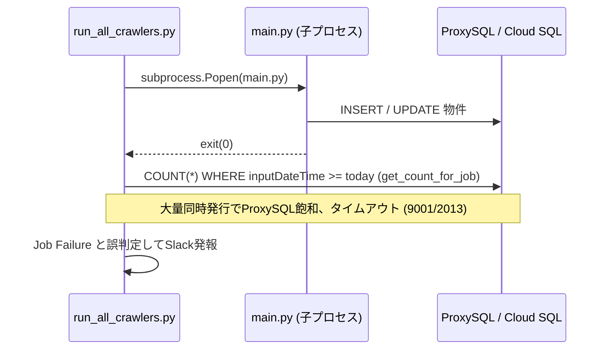
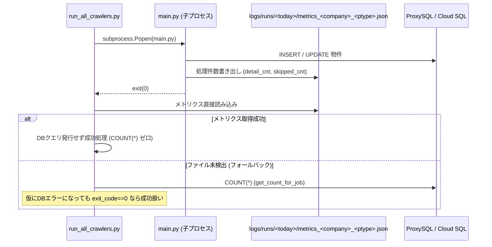

# 外部設計書: Issue #952 クローラー子プロセスからの処理件数直接回収およびステップ間DB接続回復

## 1. システム構成・フロー変更点

### 変更前フロー


### 変更後フロー


## 2. インターフェース設計

### 2.1 メトリクスファイル形式
- パス: `logs/runs/<YYYYMMDD>/metrics_<company>_<property_type>.json`
- フォーマット:
```json
{
  "company": "rearie",
  "property_type": "kodate",
  "detail_cnt": 42,
  "skipped_cnt": 5,
  "total_fetched": 47,
  "timestamp": "2026-10-16T22:30:00.000000"
}
```

### 2.2 Orchestrator (`run_all_crawlers.py`) 側ハンドリング
- 子プロセスの完了監視時、メトリクスファイルが存在するかを判定。
- 存在する場合: `count = metrics["detail_cnt"]` を取得し、DBアクセスを一切スキップ。
- 存在しない場合: 既存の `get_count_for_job()` を呼ぶが、エラーハンドリング内で `exit_code == 0` の場合はジョブステータスを `SUCCESS`（または `WARNING`）とし、`FAIL` にはしない。
