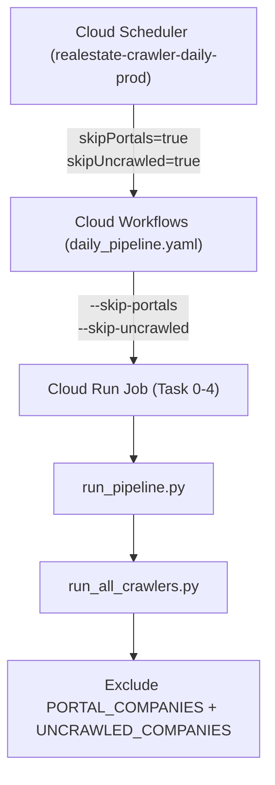

# クラウド定期実行（スケジュール）における未巡回サイト除外基本・外部設計書 (Issue #880)

## 1. システム構成・アーキテクチャ概要
Cloud Scheduler ➔ Cloud Workflows ➔ Cloud Run Job (8タスクアレイ) の日次オーケストレーションにおいて、ポータルサイト（`athome`, `homes`）の除外（`--skip-portals`）と同様に、未巡回・中堅サイト群を排除するオプション（`--skip-uncrawled` / `skipUncrawled`）を導入する。

## 2. 定義・定数設計
- **未巡回企業リスト（`UNCRAWLED_COMPANIES`）**:
  - `{"kenbiya", "ietan", "haseko", "adcast", "toho"}`
- **対象除外フラグ**:
  - CLI 引数: `--skip-uncrawled`
  - Workflows 引数: `skipUncrawled: true` (デフォルト: `true`)
  - Scheduler 引数: `skipUncrawled: true`
