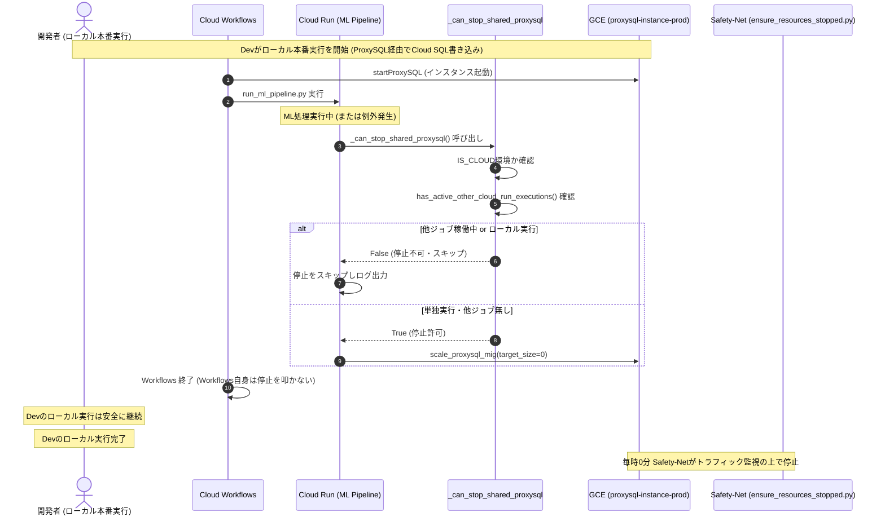

# ProxySQL停止安全ガード化と並列実行巻き込み停止防止 外部設計書 (Issue #1216)

## 1. システム全体シーケンス

## 2. 外部インターフェース仕様

### 2.1 `run_ml_pipeline.py`
- 環境変数 `IS_CLOUD` が未設定の場合：
  - ProxySQL の停止は実行されず、「ローカル環境での実行のため ProxySQL 停止をスキップします」とログ出力して終了する。
- 環境変数 `IS_CLOUD=true` の場合：
  - Cloud Run API で他実行を確認。未完了の別実行がある場合は停止をスキップし、「他ジョブ実行中のため ProxySQL 停止をスキップし Safety-Net に委譲します」とログ出力。
  - 単独実行の場合は正常に `scale_proxysql_mig(target_size=0)` を発行して終了。

### 2.2 Cloud Workflows
- `daily_pipeline.yaml`:
  - `startProxySQL` は継続（ジョブ開始時の起動責務は保持）。
  - パイプライン終了時（`stopProxySQLOnSuccess`）およびエラー時（`stopProxySQLOnError`）の即時停止ステップを撤廃。
  - ジョブ内部の Teardown および毎時 0 分の Safety-Net に停止責務を委譲。
- `recrawl_anomalies_pipeline.yaml`:
  - 同様に即時停止ステップを撤廃。
