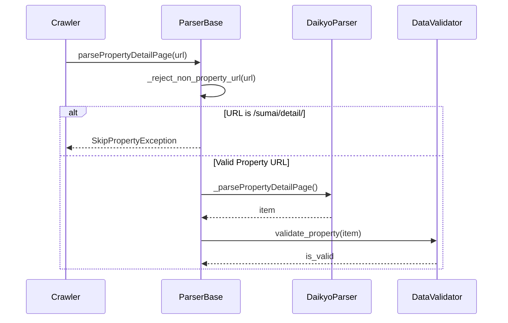

# 夜間バッチ実行エラー（三井/大京/アットホーム/Reguide/DB接続性）内部設計書 (Issue #973)

## 1. パーサー内部設計の変更点

### 1.1 大京穴吹パーサー (`DaikyoParser`)
- `_reject_non_property_url`: `BaseParser` に `/sumai/detail/` を追加し、物件詳細ページ以外の記事コンテンツを弾く。
- `DaikyoParser._normalize_detail_url`: `/sumai/` 配下のURLが渡された場合は空文字またはスキップ対象とする。
- `DaikyoParser._extract_detail_links`: 正規表現 `re.compile(r'/buy/(?:detail|[^/]+/p\d+)/')` 等により、物件URLのみを抽出する。

### 1.2 三井のリハウスパーサー (`MitsuiParser` & 種別パーサー)
- `MitsuiParser._parseTrafficLines`:
  - 交通文字列が改行なしで結合されているケース（例: `...六本木駅徒歩9分広尾駅徒歩13分...`）に対応するため、`re.split(r'(?<=分)(?=[^\d\s]+駅|[^\d\s]+線|[^\d\s]+バス)', traffic_val)` 等を用いて分割し、路線・駅・徒歩分を個別のエントリとして抽出する。
- `MitsuiInvestmentKodateParser`:
  - 一覧から区分マンションURL（`/buy/mansion/bkdetail/`）が混入した場合は `SkipPropertyException` を送出する。

### 1.3 アットホーム土地パーサー (`AthomeTochiParser`)
- `_parsePropertyDetailPage`:
  - `specs` から `土地面積`, `区画面積`, `敷地面積`, `面積` を優先順に探索する。
  - 数値が 0 または欠損している場合、本文中の `(?<!建ぺい率)(?<!容積率)(?:土地面積|敷地面積|面積)\s*[:：]?\s*([0-9,.]+)\s*(?:㎡|m2|平米)` からフォールバック抽出を行う。

### 1.4 ReguideInvestment バルク評価堅牢化 (`runner.py`)
- `evaluate_single_model`:
  - モデル評価中にテーブル未存在やデータベースエラーが発生した場合、例外をキャッチして `logger.error` に記録し、`failed_models.append(model_name)` に追加して他のモデル評価を継続する。

## 2. シーケンス・フロー図

