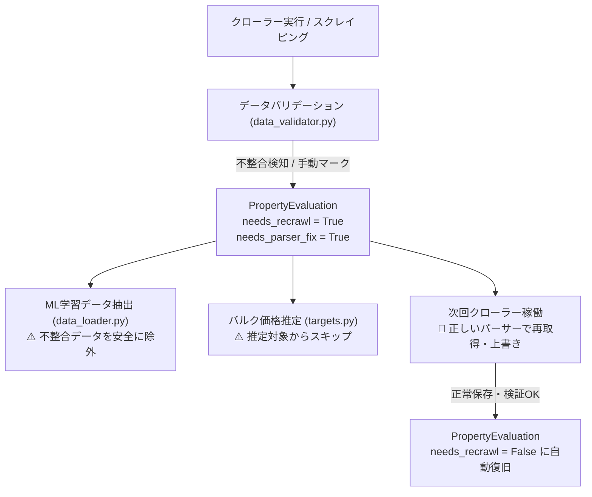

# 仕様書: データ不整合管理および横断ライフサイクルフラグ仕様 (Data Integrity & Lifecycle Flags Specification)

本ドキュメントは、不整合データの印付け、再クローリング連携、および各管理フラグの責務分担を定義した仕様書です（Issue #1047 準拠）。

---

## 1. コア設計方針: 一元横断テーブルによる管理 (Single Source of Truth)

本プロジェクトでは、各社個別テーブル（`mizuho_mansion`, `sekisui_tochi` 等の約80テーブル）に個別フラグを分散配置せず、
物件URL（`property_url`）をユニークキーとして横断管理する **`PropertyEvaluation`（テーブル名: `property_evaluation`）** を単一のデータ管理ハブとして運用します。

> [!IMPORTANT]
> **各社個別テーブルに `needs_recrawl` カラムは存在しません。**
> 不整合フラグの管理、再クローリング判定、機械学習（ML）の学習データ除外判定は、すべて横断テーブル `property_evaluation` 上で行われます。

---

## 2. カラム定義と役割 (Column Definitions)

モデル: `src/crawler/package/models/evaluation.py` (`PropertyEvaluation`)

| カラム名 | 型 (デフォルト) | 意味・役割 | 不整合時の設定値 | システム側の挙動 |
| :--- | :--- | :--- | :--- | :--- |
| **`needs_recrawl`** | `BooleanField` (default=False, db_index=True) | **再クローリング対象フラグ（不整合の印）** | **`True`** | 該当物件のデータが不整合・要更新であることを示す。<br>・MLモデル学習（`data_loader.py`）から即座に除外<br>・次回クローリング時に最新データで再取得・上書き更新 |
| **`needs_parser_fix`** | `BooleanField` (default=False, db_index=True) | **パーサー修復必要フラグ** | **`True`** (パーサー不備時) | パーサー不備やHTML構造変化が原因でバリデーションNGとなった場合に設定。Auto-Heal（自動修復）のトリガーとなる。 |
| **`data_quality_issue`** | `TextField` (default="") | **データ不備理由・エラー詳細** | **不整合理由文字列** | 例: `"Price anomaly due to card container mismatch"` などを記録。 |
| **`is_published`** | `BooleanField` (default=True, db_index=True) | **公開中フラグ** | `True` / `False` | サイト上から掲載終了した場合は `False` となり、`delisted_at` に日時がセットされる。 |
| **`delisted_at`** | `DateTimeField` (null=True) | **掲載終了検知日時** | 掲載終了時に設定 | 過去物件・成約済み物件の判別に利用される。 |

---

## 3. 不整合発生時の標準運用手順 (Inconsistency Protocol)

> [!CAUTION]
> **物理削除（TRUNCATE / DELETE）の厳禁**
> 過去の掲載実績や価格履歴（`PropertyPriceHistory`）を保全するため、不整合が発生した際に対象テーブルや物件レコードを物理削除することは全面禁止です。

### 運用ステップ:
1. **不整合の印付け (`needs_recrawl = True`)**:
   - 不整合が確認された会社・サイトの全対象物件について、`PropertyEvaluation` の `needs_recrawl` を `True` に更新します。
   ```python
   PropertyEvaluation.objects.filter(company="mizuho").update(
       needs_recrawl=True,
       data_quality_issue="Price anomaly due to card container mismatch"
   )
   ```
2. **ML学習・評価からの安全な隔離**:
   - `package/ml/training/data_loader.py` により、`needs_recrawl=True` の物件は自動的に機械学習の学習データから即座に除外され、モデル汚染を防ぎます。
3. **パーサー修正後の再クローリング実行**:
   - パーサーが修正された後、パイプラインを実行すると最新の正常な値で上書き保存され、バリデーション通過時に `needs_recrawl = False` に自動回復します。

---

## 4. ライフサイクルフロー


