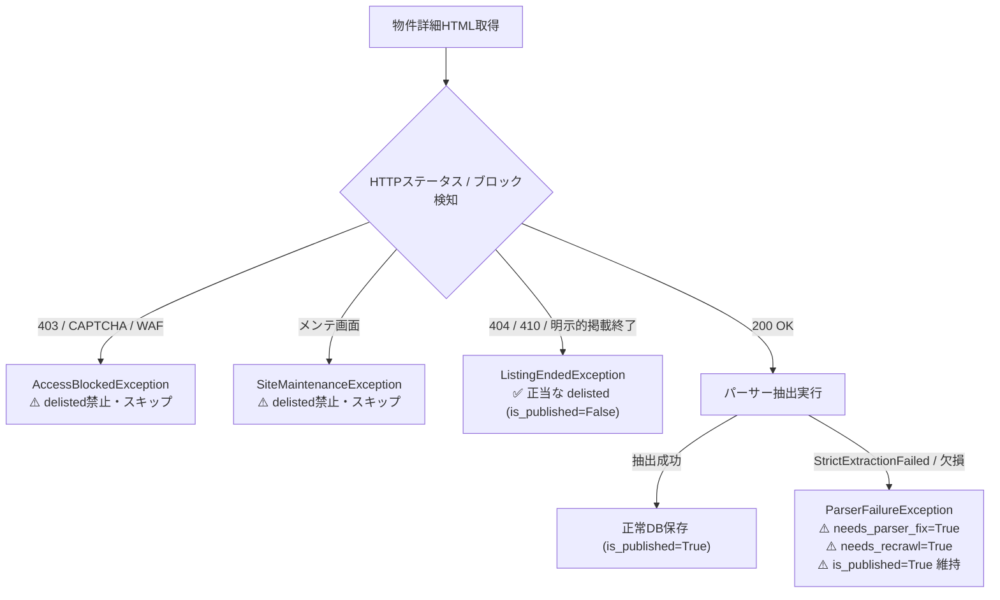

# 仕様書: 誤掲載終了（False-Positive Delisting）の撲滅とアクセス制限・メンテ画面・パース例外の防衛ガード仕様 (Issue #1265)

## 1. 背景・課題
定期クローリングやリクローリングにおいて、以下の事象が発生した際に、クローラーが物件を「掲載終了（delisted）」と誤認し、`is_published=False` に倒してしまう重大な不具合が発生した：
1. **アクセス制限・ボット認証画面（GeeTest / CloudFront 403 / Cloudflare 等）**:
   - アットホーム（`athome`）の GeeTest CAPTCHA画面（`【アットホーム】認証中`）
   - 京王不動産（`keio`）等の CloudFront 403 Forbidden（`403 ERROR The request could not be satisfied. Request blocked.`）
2. **緊急メンテナンス画面**:
   - みずほ不動産（`mizuho`）の緊急メンテナンス画面（`重要なお知らせ・店舗情報`）
3. **SPA・Vue未レンダリング画面**:
   - パナソニック リアリエ（`rearie`）のクライアントレンダリング待機画面
4. **セレクタ抽出失敗・必須項目欠損 (`StrictExtractionFailed`)**:
   - 健美家（`kenbiya`）等で、パース抽出失敗時に `SkipPropertyException` が送出され、それが `_handle_skipped_property` により `delisted` に倒されていた。

これらはいずれも「物件が売却・掲載終了した」のではなく、**「一時的な通信・認証遮断」または「サイト側の一時メンテナンス」「パーサーの改修必要」** であり、`is_published=False` にしてはならない。

---

## 2. 設計方針・変更仕様

### 2.1 例外ヒエラルキーの厳格化
- `SkipPropertyException`（基底スキップ例外）配下に以下のサブクラスを明確に区別する：
  1. `ListingEndedException(SkipPropertyException)`: **正規の掲載終了・404 Not Found の場合のみ送出**。これのみが `delisted`（`is_published=False`）の対象となる。
  2. `ServerBusyException(SkipPropertyException)`: サーバー混雑・過負荷。
  3. `SiteMaintenanceException(ServerBusyException)`: サイトメンテナンス画面。
  4. `AccessBlockedException(ServerBusyException)`: WAF / CloudFront / CAPTCHA / 403 遮断画面。
  5. `ParserFailureException(SkipPropertyException)`: セレクタ不一致・必須項目欠損等のパーサーエラー。

### 2.2 ボット認証・アクセス遮断検知の基底共通化
- `check_access_blocked_or_maintenance(soup, status_code, url)` を `baseParser.py` に配備。
  - タイトル、h1、body テキストから CAPTCHA（`認証中`、`geetest`、`Just a moment...` 等）やブロック（`Request blocked`、`403 ERROR`、`CloudFront`、`Cloudflare` 等）を検知した場合、即座に `AccessBlockedException` または `SiteMaintenanceException` を送出する。
  - `_raise_if_listing_ended` の前段で必ずこのチェックを呼び出し、ブロック画面が掲載終了と判定されることを物理的に遮断する。

### 2.3 `_fetch_detail_item` と `_treatPage` の防衛ガード
- `_fetch_detail_item` の戻り値を `(item, is_listing_ended, is_parser_failure)` のように明確化、または例外ハンドリングを細分化する。
- **`is_listing_ended=True`（`ListingEndedException` 送出時）のみ `_handle_delisted_property()` を呼び出し、`is_published=False` に更新する。**
- `ParserFailureException` や `LoadPropertyPageException` が発生した場合は、`_handle_parser_failure_property()` により `needs_parser_fix=True`, `needs_recrawl=True`, `is_published=True`（公開状態を維持）として安全に隔離する。
- `ServerBusyException`, `SiteMaintenanceException`, `AccessBlockedException` の場合は、DB上のフラグを変更せず（`delisted` に倒さず）、次回リトライ対象として安全にスキップする。

---

## 3. ライフサイクルフロー

